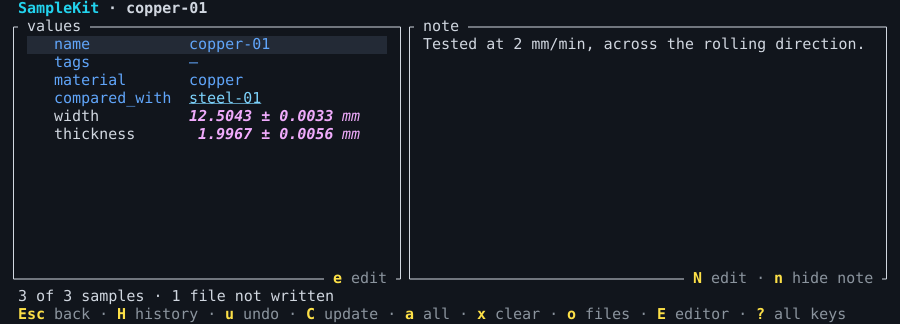
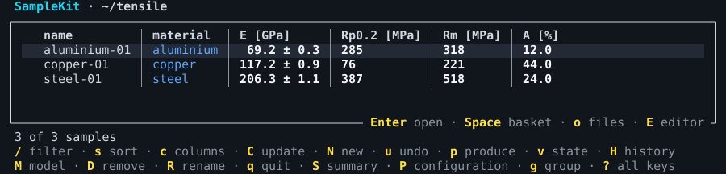
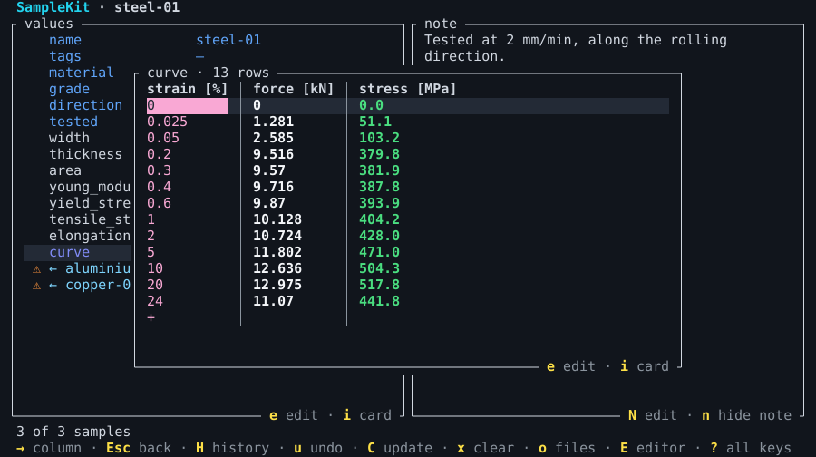
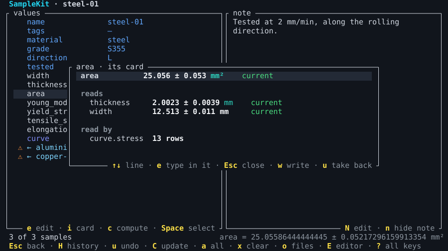
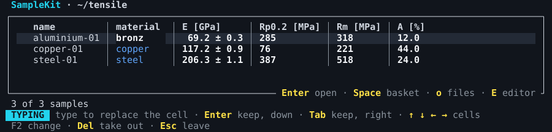
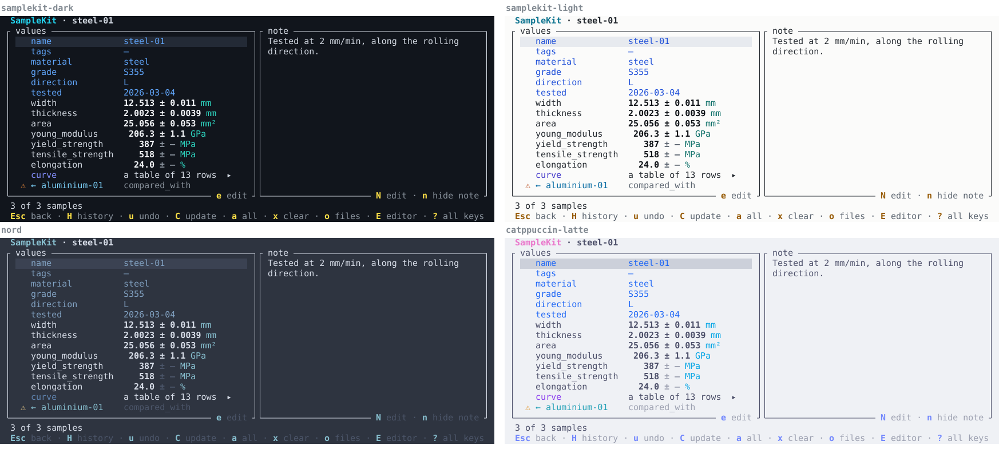

# 

**Sample data in plain Markdown: computed, current, tracked.**

Which value was computed from which measurement? Was this table made before or
after the thickness was measured again? Is the figure in the draft still
right? SampleKit answers these questions for a folder of plain text files:
one sample, one Markdown file, readable in any editor, in Obsidian, and in
git.

```yaml
---
schema_version: 1
name: copper-01
material: copper
compared_with: "[[steel-01]]"
properties:
  width: {readings: [12.509, 12.498, 12.506], unit: mm}
  thickness: {readings: [1.995, 1.988, 2.007], unit: mm}
---
Tested at 2 mm/min, across the rolling direction.
```

Above the second `---` are the sample's data: attributes, values with their
uncertainties and units, readings, tables of measurements. Below is a note
that is yours, kept as you write it. A folder of such files is a project,
with no database and nothing to set up.

The same file opened in SampleKit: its width and thickness computed from
their readings, each with its uncertainty, in italics until `w` writes them
into the file.



## What it does

- **Computed**: the values that derive from your measurements, an area, a
  modulus, a whole column of stress, come from formulas you write in Python,
  uncertainties included.
- **Current**: SampleKit knows which results still rest on the measurements
  they were computed from, and says which do not, and why.
- **Tracked**: every change it writes is kept in a history of the project's
  own, with the command that made it, and no git to install. `--at` reads the
  project as it was, and makes a table or a figure again exactly as it was.
- **Tables and figures**: select, sort and group samples, then write a CSV, a
  LaTeX or Markdown table, or a matplotlib figure, in one style for the whole
  project, by one command you run again at each draft.
- **Linked**: a sample names another, a file or a web page, as Obsidian and
  Markdown write a link; SampleKit follows it both ways, checks it, and keeps
  it when a sample is renamed.
- **Three ways in**: a command line, a full-screen terminal interface, and a
  Python package reading the same files with the same names.

Every picture on this page is drawn by SampleKit itself, by its tests: each
shows what this version does, and is drawn again when that changes.

## The terminal interface

`samplekit` alone opens it, full screen. Here a sample is opened, a value
typed with its uncertainty, what it feeds turns out of date at once, the
value's card shows where it comes from, and the changes are previewed and
written as one.



**The samples**, a row each, the columns yours to choose; `/` filters them,
`s` sorts them, `g` groups them. What describes a sample is blue, what
measures it white.



**A sample's table**, opened by `Enter`, here steel-01's tensile curve. The
strain, pink, is the index the rows are known by; the force, white, was
measured; the stress, green, is computed by the model from the force and the
area, and green says it is current. It would turn orange, marked `⚠`, as
soon as the force or the area changed.



**A value's card**, `i`: where a value comes from, what it reads and what
reads it, each with its state. Each line is typed over there, and what the
change makes out of date is seen at once. At the foot, the value under the
cursor with every digit it has.



**The typing mode**, `e`: as in a spreadsheet, what is typed replaces the
cell and the arrows go from cell to cell, in a sample, in a table, and in the
list of samples itself, a column at a time. Nothing is written until `w`,
which shows every change waiting in one preview.



### Themes

The terminal interface draws in SampleKit's own theme, dark or light as your
terminal is, each colour chosen for its role and checked for contrast; a
terminal that does not say it draws every colour keeps its own sixteen. Ten
more are built in: `terminal` (your terminal's sixteen colours),
`catppuccin-mocha`, `catppuccin-latte`, `dracula`, `nord`, `tokyo-night`,
`gruvbox-dark`, `gruvbox-light`, `solarized-dark` and `solarized-light`.



`T` lists them, each tried on the screen as the cursor reaches it, and
`Enter` keeps one; a project names its own with `theme = "nord"` in its
`[colors]`. Your own themes are files in `~/.config/samplekit/themes/` on
Linux, each a `[colors]` table over the theme its `base` names.
[Choose the colours](https://zelyph.github.io/SampleKit/latest/guides/colours.html)
shows each of them and says more.

## The command line

Everything the terminal interface does has its command, for a script, a
makefile or a quick look. Here, on the demo: the samples a filter keeps, a
reading changed and what it makes out of date, the model's preview of what it
computes again, then written; `validate` finding a link that leads nowhere,
and a table printed as CSV.



More, from the same demo:

```console
$ samplekit -c name,material,tensile_strength -s -tensile_strength   # a table, sorted
$ samplekit status                                # what is not current, and why
$ samplekit export paper --write                  # a LaTeX table for a paper
$ samplekit samples/steel-01.md view curve --csv  # a sample's curve, as CSV
$ samplekit samples/steel-01.md log               # every change kept, and what made it
```

## From Python

The Python package reads the same files, by the same names:

```python
import samplekit as sk

for specimen in sk.load("samples").filter("elongation > 20"):
    print(specimen.name, specimen.young_modulus.value, specimen.young_modulus.uncertainty)
```

## Install

The command line is one file: download it for Linux, macOS or Windows from
[the releases](https://github.com/zelyph/SampleKit/releases), or build it with
Rust:

```console
$ cargo install samplekit --locked --version VERSION
```

The Python package goes into each project's `.venv/`, at the version of the
command line, `VERSION` being what `samplekit --version` says; `samplekit
init` makes that environment and installs it for you:

```console
$ pip install samplekit==VERSION
```

> **Until 1.0, name the version.** `pip install samplekit` alone gives 0.2.0,
> the previous version, whose API is not this one; likewise the *Latest*
> release on GitHub is 0.2.0, and this version's archives are under its own
> release, marked *pre-release*.

[Install SampleKit](https://zelyph.github.io/SampleKit/latest/guides/install.html)
says more, system by system. **From an earlier version**, 0.x or 1.0.0-rc.1,
`samplekit-migrate.pyz`, in each release, carries a project into a new
folder this version reads, and says what to check by hand
([upgrade](https://zelyph.github.io/SampleKit/latest/guides/upgrade.html)).
It never writes in the folder it reads; back your project up all the same.

## Try the demo

`samplekit` alone opens its start page; `g`, then *The demo*, writes a
tensile test in six steps, from three specimens measured by hand to their
curves, results, a paper's tables and figures and the links between them, and
opens the first.
[The documentation](https://zelyph.github.io/SampleKit/latest/) walks
through it, then goes further: guides a task each, the concepts, and the
reference.

## Where things are

|                                                                                                 |                                                                                                                                                                                                                                                                                                  |
| ----------------------------------------------------------------------------------------------- | ------------------------------------------------------------------------------------------------------------------------------------------------------------------------------------------------------------------------------------------------------------------------------------------------ |
| [`docs/`](https://zelyph.github.io/SampleKit/latest/index.html)                                 | The documentation: the home page's walkthrough of the demo, [guides](https://zelyph.github.io/SampleKit/latest/guides/index.html), [concepts](https://zelyph.github.io/SampleKit/latest/concepts/index.html) and the [reference](https://zelyph.github.io/SampleKit/latest/reference/index.html) |
| `src/`, `tests/`                                                                                | The Rust crate: the core, the command line, the terminal interface and the Rust half of the Python package; a test file per source file                                                                                                                                                          |
| `python/samplekit/`                                                                             | The Python half of the Python package                                                                                                                                                                                                                                                            |
| [`examples/tensile/`](https://github.com/zelyph/SampleKit/blob/main/examples/tensile/README.md) | The demo, in six steps, generated from `fixtures/tensile/`; the start page writes it for you                                                                                                                                                                                                     |
| `fixtures/tensile/`                                                                             | What the demo is generated from: its model, scripts and READMEs, and the generator                                                                                                                                                                                                               |
| [`migrate/`](https://github.com/zelyph/SampleKit/blob/main/migrate/README.md)                   | The migration tool, `samplekit-migrate.pyz` in each release                                                                                                                                                                                                                                      |

## Building

```console
$ cargo build --release                  # the command line: target/release/samplekit
$ python -m venv .venv && source .venv/bin/activate
$ pip install maturin
$ maturin develop --release              # the Python package, into .venv
$ tools/check.sh                         # everything a commit must pass
```

The documentation is a Sphinx site, built from `docs/` into `target/site`,
after `maturin develop`, since the Python reference reads the package:

```console
$ .venv/bin/pip install -r docs/requirements.txt
$ .venv/bin/sphinx-build docs target/site
```

The command line needs no Python to read, select, render, check or export;
Python runs a project's model, and matplotlib draws its figures.

## Status

Version `1.0.0-rc.3` (`1.0.0rc3` as Python spells it), the third release
candidate of `1.0.0`. It follows `0.2.0`, the previous implementation, in
Python alone, published under the same name. What changed is in
[CHANGELOG.md](https://github.com/zelyph/SampleKit/blob/main/CHANGELOG.md).

## Roadmap

In order of priority:

- [ ] **1.0**: this release candidate, tried, then published as `1.0.0`;
  from then on, `pip install samplekit` gives it without naming a version.
- [ ] **An Obsidian plugin**, so that a project opened as a vault shows its
  properties and tables as SampleKit does, hides what only SampleKit reads,
  such as `schema_version`, and edits them: a laboratory notebook in which
  notes on the literature, the samples, their computed data and their
  figures stand together and stay consistent, for whoever does not work in a
  terminal.
- [ ] **Designs of experiments**: full and
  fractional factorials, central composite, Box-Behnken, definitive
  screening and mixture designs, with centre points, replicates, blocks and
  a randomised order. SampleKit lays out a plan's runs, makes a sample of
  each, takes in the samples already made, says which runs are still to
  make, and analyses what they measured: a model per response, reduced and
  tested term by term, its residuals examined, then used to predict,
  optimise and draw; in the terminal interface and from Python too.

## Licence

MIT: see [LICENSE](https://github.com/zelyph/SampleKit/blob/main/LICENSE).
Keep the notice with any copy; everything else is permitted, including
commercial use.
