# Choose the colours

This guide is for the colours of the terminal interface and of the command
line. The terminal interface draws in a **theme**: SampleKit's own, dark or
light, unless you choose another. Twelve are built in, each drawn below by
the terminal interface itself, and you can make your own.

## Choose a theme

Press `T` on the collection, on a sample or on the start page: the list of
every theme opens, those SampleKit has first, then your own. The screen takes
the theme under the cursor at once, so that you see it before you keep it;
`Enter` keeps it, `Esc` gives back the one there was.

What `Enter` keeps is yours, not the project's: the theme for this folder,
remembered with it as its filter and its columns are, and your last choice,
which a project naming no theme of its own opens in. The theme in force is,
first to last:

1. the theme you chose with `T` in this folder;
2. the theme the project names, `theme = "nord"` in its `[colors]`, shared
   with whoever opens it (the list says *this project names nord*);
3. the last theme you chose with `T` anywhere;
4. SampleKit's own: `samplekit-dark`, or `samplekit-light` where the
   terminal says its background is light (in the variable `COLORFGBG`,
   which some terminals set). That is where the terminal draws every
   colour, as it says in `COLORTERM` (`truecolor` or `24bit`), and in
   Windows Terminal; elsewhere, the old Windows console, macOS's Terminal or
   a session over SSH for instance, the default is `terminal`, your
   terminal's own sixteen colours, which any terminal draws.

Choosing in a project the theme it names keeps nothing for the folder, so
that you see the project's theme if it changes. A theme named that this
machine does not have, one of your own removed or one a colleague's project
names, is said on the status line, and the next in the list is taken.

The command line has no theme: it writes on the terminal's own background,
in the terminal's sixteen colours, the project's roles over them.

## How `[colors]` works

A project's `.samplekitrc` changes colours by **role**, in the section
`[colors]` (the key keeps its American spelling), over whichever theme is in
force. Each role is one kind of thing on the screen: a value not current, a
unit, a key named at the foot. Twenty roles:

| Role | What it colours |
| --- | --- |
| `background` | the terminal interface's whole screen |
| `foreground` | its text, where nothing else colours it |
| `failed` | a value whose formula failed |
| `outdated` | a value that is not current |
| `edited` | a value written by hand over its formula |
| `current` | a computed value that is current |
| `selected` | the line or item under the cursor, the basket |
| `attribute` | attributes, and an attribute's value |
| `link` | a link, underlined |
| `value` | a value and its uncertainty, drawn bold |
| `unit` | a unit, after a number and in a header |
| `table` | tables |
| `index` | a table's index column |
| `key` | keys, in the help and at the foot |
| `muted` | secondary text |
| `message` | messages |
| `error` | errors |
| `accent` | the name in the title bar, a computation in progress |
| `waiting` | what waits to be written, in italics |
| `line` | the background of the cursor's line, the cell typed in reversed on it in the typing mode |

```toml
[colors]
theme = "nord"        # this project's theme, unless you chose one with T here
outdated = "#ff8800"  # and over it, outdated values in orange
```

A colour is written in one of three ways:

- `default`, the terminal's own text colour (or its background, for
  `background`);
- one of the terminal's sixteen by name, `red` or `light-blue` for
  instance ([the configuration reference](../reference/configuration.md#colors)
  lists them): the terminal's theme decides its shade;
- `#rrggbb`, a colour fixed whatever the terminal's theme, which the terminal
  must be able to draw (most do).

A role or a colour SampleKit does not know is refused, with the line and
what it accepts. What waits to be written is drawn in italics as well as in
the `waiting` colour: the italics tell it apart whatever the colour.

## Your own themes

A theme of your own is a file in the folder `themes` of SampleKit's
configuration folder: `~/.config/samplekit/themes/` on Linux (or under
`$XDG_CONFIG_HOME`), `~/Library/Application Support/samplekit/themes/` on
macOS, `%APPDATA%\samplekit\themes\` on Windows. The variable
`SAMPLEKIT_CONFIG_DIR` names another configuration folder. The file's name
is the theme's: `my-nord.toml` is `my-nord`, listed by `T` after the themes
SampleKit has.

The file is a `[colors]` table, with the theme it starts from above it,
`base`: each role the table leaves out is the base's. Without `base`, it
starts from `samplekit-dark`; a base may be another of your own.

```{literalinclude} ../templates/themes/my-nord.toml
:language: toml
:caption: my-nord.toml
```

{download}`Download my-nord.toml <../templates/themes/my-nord.toml>`

A file that does not read, a base no theme bears, a role or a colour that is
none, or a name SampleKit's own themes already have: the theme is left out,
and the terminal interface says why as it opens, and at the foot of `T`'s
list.

## The themes SampleKit has

Below, each theme SampleKit has, by the name `T` lists and `theme =` takes,
its file and the terminal interface drawn in it. You can also copy a file's
`[colors]` table into a `.samplekitrc`, or start your own from it. The
picture is the screen of a sample of the demo, `steel-01`, its width typed
again: what it feeds is outdated, the change waits.

`terminal` is the one theme without a file: the terminal's sixteen colours,
as the command line draws them, on the terminal's own background.

## SampleKit dark

SampleKit's own theme for a dark terminal, and the default. Each role has a
colour of its own, and every colour is chosen to be read: the text and the
values at a contrast of 7:1 at least against the background, and against the
cursor's line, every other role at 4.5:1, by
[WCAG's measure](https://www.w3.org/TR/WCAG21/#contrast-enhanced). A test
computes these contrasts, so that a colour changed cannot fall below them.

```{literalinclude} ../templates/colours/samplekit-dark.toml
:language: toml
:caption: samplekit-dark.toml
```

{download}`Download samplekit-dark.toml <../templates/colours/samplekit-dark.toml>`

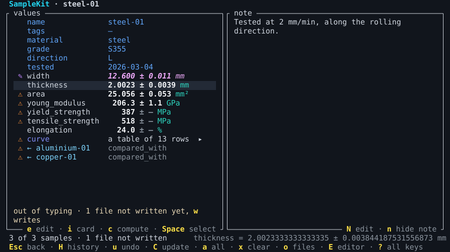

## SampleKit light

SampleKit's own theme for a light terminal, the default where the terminal
says its background is light, made to the same contrasts.

```{literalinclude} ../templates/colours/samplekit-light.toml
:language: toml
:caption: samplekit-light.toml
```

{download}`Download samplekit-light.toml <../templates/colours/samplekit-light.toml>`

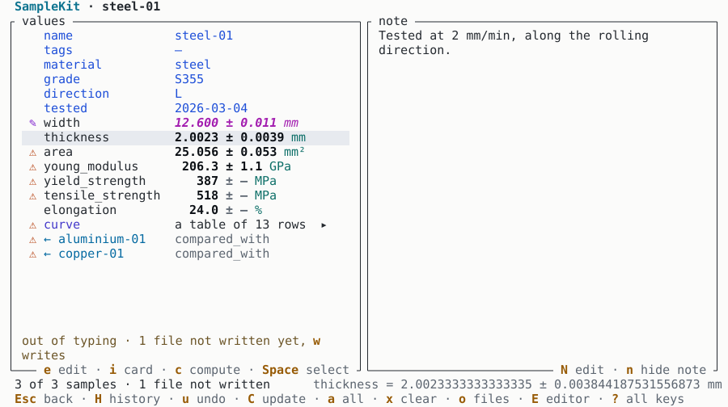

## Catppuccin Mocha

Catppuccin's palette, [catppuccin.com](https://catppuccin.com), its dark flavour Mocha.

```{literalinclude} ../templates/colours/catppuccin-mocha.toml
:language: toml
:caption: catppuccin-mocha.toml
```

{download}`Download catppuccin-mocha.toml <../templates/colours/catppuccin-mocha.toml>`

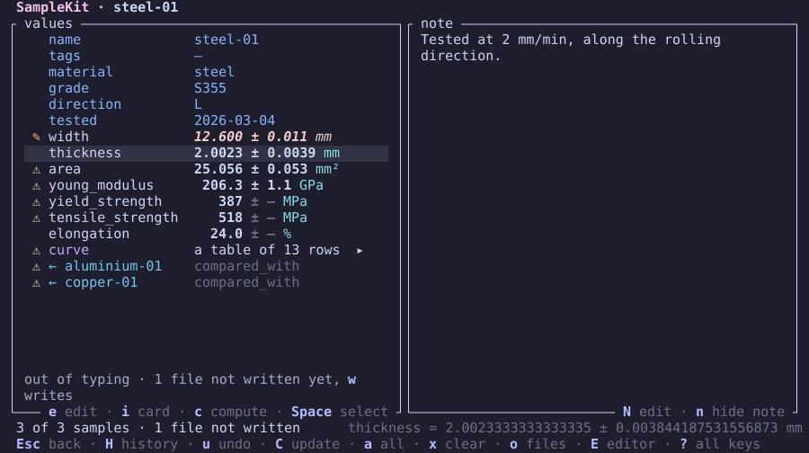

## Catppuccin Latte

Catppuccin's palette, [catppuccin.com](https://catppuccin.com), its light flavour Latte.

```{literalinclude} ../templates/colours/catppuccin-latte.toml
:language: toml
:caption: catppuccin-latte.toml
```

{download}`Download catppuccin-latte.toml <../templates/colours/catppuccin-latte.toml>`

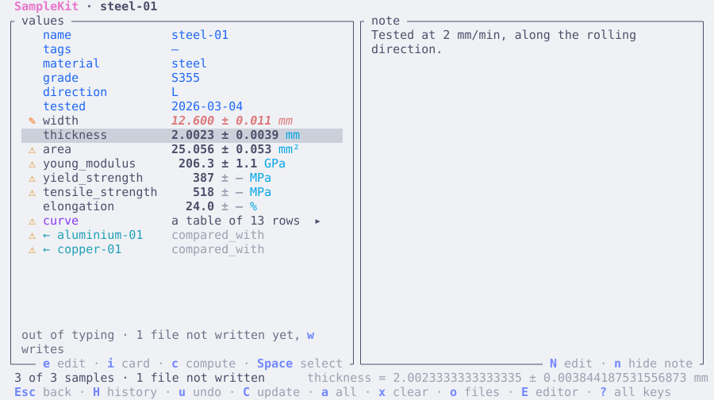

## Dracula

Dracula's palette, [draculatheme.com](https://draculatheme.com).

```{literalinclude} ../templates/colours/dracula.toml
:language: toml
:caption: dracula.toml
```

{download}`Download dracula.toml <../templates/colours/dracula.toml>`

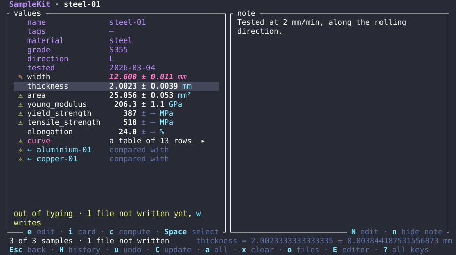

## Nord

Nord's palette, [nordtheme.com](https://www.nordtheme.com), `nord0` to `nord15`.

```{literalinclude} ../templates/colours/nord.toml
:language: toml
:caption: nord.toml
```

{download}`Download nord.toml <../templates/colours/nord.toml>`

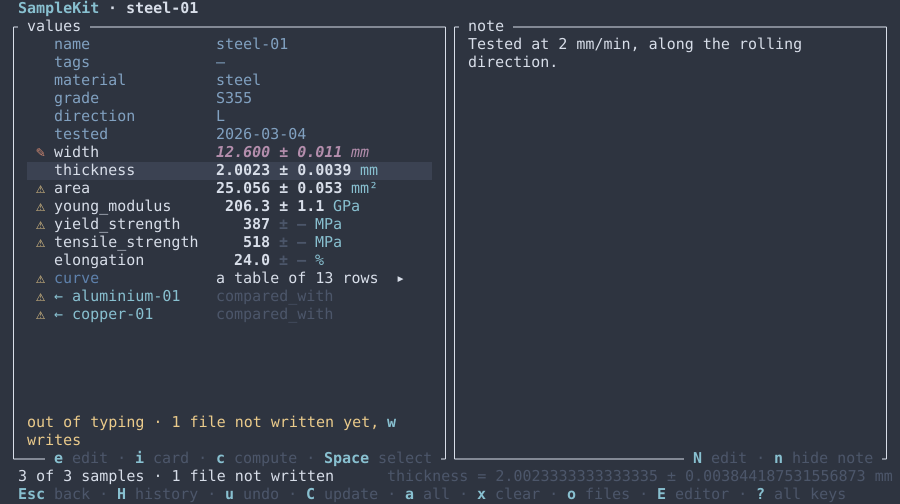

## Tokyo Night

Tokyo Night's palette, [github.com/folke/tokyonight.nvim](https://github.com/folke/tokyonight.nvim), its style Night.

```{literalinclude} ../templates/colours/tokyo-night.toml
:language: toml
:caption: tokyo-night.toml
```

{download}`Download tokyo-night.toml <../templates/colours/tokyo-night.toml>`

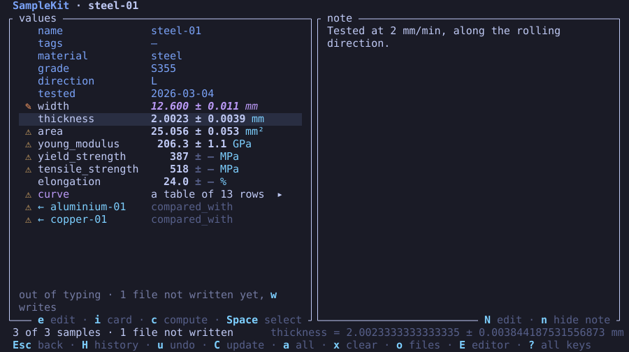

## Gruvbox dark

Gruvbox's palette, [github.com/morhetz/gruvbox](https://github.com/morhetz/gruvbox), dark.

```{literalinclude} ../templates/colours/gruvbox-dark.toml
:language: toml
:caption: gruvbox-dark.toml
```

{download}`Download gruvbox-dark.toml <../templates/colours/gruvbox-dark.toml>`

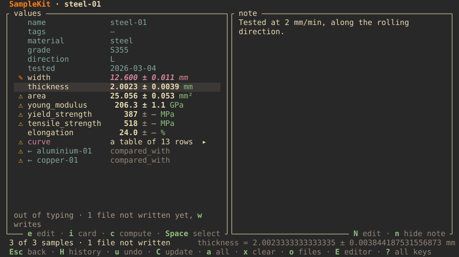

## Gruvbox light

Gruvbox's palette, [github.com/morhetz/gruvbox](https://github.com/morhetz/gruvbox), light.

```{literalinclude} ../templates/colours/gruvbox-light.toml
:language: toml
:caption: gruvbox-light.toml
```

{download}`Download gruvbox-light.toml <../templates/colours/gruvbox-light.toml>`

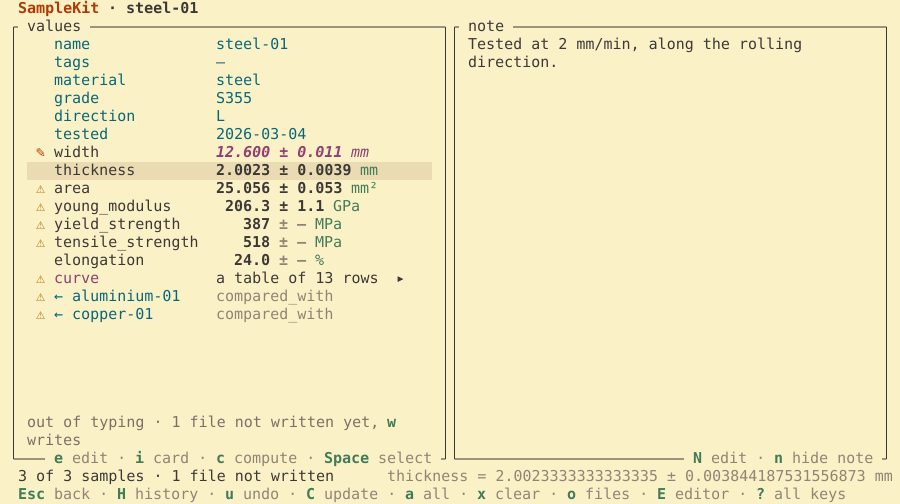

## Solarized dark

Solarized's palette, [ethanschoonover.com/solarized](https://ethanschoonover.com/solarized/), dark.

```{literalinclude} ../templates/colours/solarized-dark.toml
:language: toml
:caption: solarized-dark.toml
```

{download}`Download solarized-dark.toml <../templates/colours/solarized-dark.toml>`

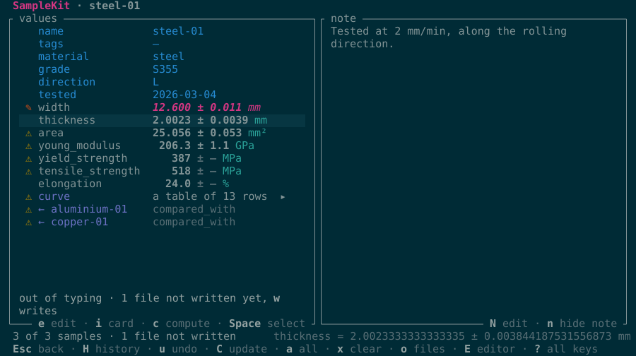

## Solarized light

Solarized's palette, [ethanschoonover.com/solarized](https://ethanschoonover.com/solarized/), light.

```{literalinclude} ../templates/colours/solarized-light.toml
:language: toml
:caption: solarized-light.toml
```

{download}`Download solarized-light.toml <../templates/colours/solarized-light.toml>`

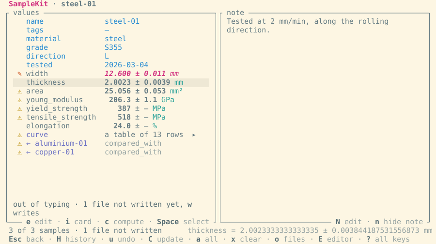

## See also

- [Work in the terminal interface](terminal-interface.md).
- [`[colors]`](../reference/configuration.md#colors) in the configuration
  reference.
