# Work in the terminal interface

This guide is for working with your samples from one full-screen view, by the
keyboard rather than by commands: browse and filter them, open one, change a
value, compute, draw, read the history. The terminal interface, the *TUI*,
does what the commands do, and shows the same previews before it writes.

## Open it

`samplekit` alone, in a terminal, opens its **start page**. It offers the
project of the folder you are in first, then the projects you opened
recently; `Enter` opens the one marked, `1` to `9` a recent one. From the
start page, `n` sets up a new project by a few questions, `o` opens another
folder, and `g` opens this documentation in the browser, or the demo: the
[home page](../index.md)'s tensile test in six steps, each a project to try.

`samplekit FOLDER tui` opens a folder directly, past the start page.

The foot of each screen names the keys used most, and ends with `? all keys`:
`?` lists every key of the screen you are on, and `q` goes back to the screen
you came from, until it quits. Every key is also listed in [the TUI's
keys](../reference/tui.md).

`T`, on the start page, the collection or a sample, chooses the TUI's
**theme**: each is tried on the screen as the cursor reaches it, and `Enter`
keeps it ([choose the colours](colours.md)).

## The list of samples

The TUI opens on the **collection**: one row per sample, its columns those
you choose. The keys to try first:

| Key | What it does |
| --- | --- |
| `/` | type a filter, as after `-f`; `Tab` completes, `Esc` clears it |
| `s` | sort by a column; `r` reverses |
| `c` | choose the columns |
| `g` | group by a field |
| `f` | apply a saved query or profile |
| `Enter` | open the sample under the cursor |
| `N` | a new sample beside the one under the cursor: its name, then `field=value` …, and `keep:material,grade` to take fields from it |
| `Space` | put the sample in the basket: `C`, `p`, `t` and `D` then act on the basket alone |
| `C` | update: show what is not current, and compute it on `y`; a value typed over its formula is kept, and said |
| `t` | tag the basket, `-tag` to take a tag off, or `old=new` to rename one |
| `D` | remove the sample, or the basket's: its file, asked first |
| `R` | rename the sample, its own files and the links leading to it, asked first |
| `v` | the collection's state: every value not current, in the words of `samplekit status`, then what is wrong |
| `H` | the history, change by change |
| `u` | take back the last change |
| `p` | run a script, draw a figure, or write an export |
| `W` | save what is shown as a query, a profile or an export |

A mark tells a value's state, as in a table of the command line: `⚠` not
current, `✎` written by hand over its formula, `✗` failed, `∅` never computed
or waiting ([current and outdated](../concepts/current-and-outdated.md)).

The TUI remembers, for each folder, the filter, the sort, the grouping, the
columns and the basket, and opens there next time; `x` empties the basket.

## A sample

`Enter` on a sample opens it: its attributes, its values and the marks of
their states, its tables, its note.

| Key | What it does |
| --- | --- |
| `e` | the typing mode, on the cell under the cursor: see [Typing](#typing) |
| `i` | the value's card: see [A value's card](#a-values-card) |
| `A` | add an attribute: its name, then its value |
| `N` | write the note; `Esc` shows the change |
| `→` | open the table under the cursor; there, `e` on the empty last row adds one |
| `c` | compute the value under the cursor, even typed over its formula |
| `C` | update the sample: compute what is not current in it |
| `o` | open the sample's own files: its photos, its reports |
| `Enter`, `o` on a link | follow an attribute `"[[steel-02]]"` or `"[text](path)"`: a sample on its screen, a file in its application, a page in the browser; on a list of links, `Enter` opens its items and `o` follows one, as `Enter` does on an item |
| `R` | rename the sample, its own files and the links leading to it |
| `p` | the scripts, figures and exports of the sample |

A link is shown as Markdown shows it: its text alone, underlined, `↗` after
a web page and `✗` after a link that leads nowhere. A sample a link opens is
shown on its screen even where the filter leaves it out, or it belongs to
another project. The title bar says the way taken, `steel-01 ›
aluminium-01`, and `Esc` goes back along it, to the line of the link
followed. After everything a sample holds come the samples linking to it,
*linked from*: `Enter` follows one as a link. Typing a value, `Tab` after
`[[` completes a sample's name ([link samples](link-samples.md)).

`E` opens the sample's file, and `M` the project's model, in your editor:
the one `VISUAL` or `EDITOR` names, else Notepad on Windows and the system's
application for the file elsewhere; the TUI waits until it is closed, and
reads the file again. An editor of its own window, Notepad or `code --wait`,
leaves the TUI drawn, saying what it waits for; one in the terminal, `vim` or
`nano`, takes the terminal while it runs. `n` on one of a sample's own files, after `o`, shows it
in its folder, selected in Windows's Explorer.

## Typing

`e` enters the **typing mode** on the cell under the cursor, as
Vim's insert mode is entered: `TYPING` at the foot of the screen says so, and
every other key keeps its meaning outside it. In the typing mode:

| Key | What it does |
| --- | --- |
| a letter, a digit | replaces the cell with what you type |
| `Enter` | keeps the cell and goes down; on a cell not typed in, changes it without replacing it |
| `Tab` | keeps the cell and goes right |
| `↑` `↓` `←` `→` | go from cell to cell, keeping a cell typed in |
| `F2` | changes the cell without replacing it |
| `Delete` | takes out the attribute, or the table's row, under the cursor |
| `Esc` | leaves the cell typed in, then the typing mode |

A sample's line is its cells: an attribute's name and its value, a value
with its uncertainty, its readings. Typing over a name renames the attribute;
`A`, out of the typing mode, adds one. A value and its
uncertainty are typed in one cell, with `+-`, which every keyboard has: `12.6
+- 0.02`, shown `12.6 ± 0.02`. `12.6` alone keeps the uncertainty, and `12.6
+-` takes it out; a value without one shows `± —`, where it can be given, and
opens as `12.6 +- `. A value opens as it is shown, rounded:
left as it is, it keeps every digit it has. A cell never widens as you type
in it: its text scrolls inside it. The end of the status line shows the value
under the cursor with every digit, `width = 12.513333333333334 ±
0.010088497300281277 mm`.

A table is typed cell by cell in the same way, and its empty row at the foot
takes a new row, written once its index is given. The list of samples is
typed in too, without opening a sample: `←` `→` choose the column, and
`Shift+↑` `Shift+↓` take several rows in the typing mode, what you type then
going to each; a sample in the basket takes it with the basket's others.

Lines are edited as in a text editor: the mouse or `Shift` and the arrows
select, `Ctrl` and the arrows move by word, `Ctrl+Z` undoes.

## A value's card

`i` on a value, or on a table's cell holding one, opens its **card**: its
value with its uncertainty and its unit, its readings, its state in words and
why, then what it **reads** and what **reads it**, each with its value and its
state. A line of a sample shows only the mark of its value's state, `⚠`,
`✎`, `✗` or `∅`; its words are the card's. `↑` `↓` go from line to line of
the card, and `e` types over the line under the cursor, as the typing mode
does: the value itself, one it reads, or one that reads it. The change waits,
as every change does, and the card is drawn again as it makes it: what reads
a value changed is seen outdated at once. `Esc` closes the card.

## Changes wait until `w` writes them

Nothing you change is written at once: a value, a row, an attribute, the
note, tags, a sample made with `N`, removed with `D` or renamed with `R`, what
a script changes, a state restored from the history, and what a computation
gives. Each change **waits**, and the screens show the files as it makes
them: what changed, and a sample made, in italics and in their own colour,
the theme's `waiting`
([choose the colours](colours.md));
what is taken out is no longer shown, and the status line counts the files
not written. The files themselves are untouched until you write them,
so a computation can be tried and looked at before it counts: one that went
wrong is dropped, and leaves the history as it was.

| Key | What it does |
| --- | --- |
| `w` | one preview of everything waiting, file by file; `y` writes it all, one change of the history |
| `u` | takes back the last change waiting; once nothing waits, the last change written |

`C` shows what it would compute, as `compute` does, and `y` computes; `c`
computes the value under the cursor at once. What they give waits with the
rest. Leaving with changes waiting asks whether to write them (`w`), drop
them (`d`) or keep them for next time (`k`); the terminal closed without the
question keeps them. Opened again, the project offers what waits, how many
files and since when.

A file changed meanwhile by another hand, in an editor or on the command line,
is not written over: what waits for it is laid again over the file as it now
is, field by field, and where both changed the same field, `w` says so and
writes nothing. An export and a figure are made from what is shown, changes
waiting included.

`H` lists the history, each change and what it changed: there, `r` puts the
files back as a change left them, the change waiting as any other. `d` shows
what one change changed, and marks it; `d` on another then compares the two,
value by value, as `restore --at` and `diff` do ([the
history](../concepts/history.md)).

## Scripts, figures and exports

`p` opens one menu of what the project offers, in three groups: the scripts,
the figures and the exports, `Tab` from one group to the next. They act on the
basket, on the sample open, or on the samples shown. A figure opens in a
window, or `w` writes it to a file; one the model draws for one sample is
written a file per sample, the name offered holding `{name}`,
`yield_point-{name}.pdf`. A script runs in a window that shows what it prints
as it prints it; a question it asks with `input()` is answered on the line at
the window's foot ([run a script](run-a-script.md)). An export is previewed
before `y` writes it, and its first line, *what is shown*, writes the screen's table once to a
file you name.

## Several projects

Opened on a folder above several projects, the TUI shows their samples
together, each part headed by its project, and offers the figures and exports
of the project the samples shown belong to ([several projects](several-projects.md)).

## See also

- [The TUI's keys](../reference/tui.md), screen by screen.
- [Choose the colours](colours.md): the themes SampleKit has, each drawn by
  the TUI, and how to make your own.
- The [home page](../index.md) does with commands what this guide does with
  keys.
