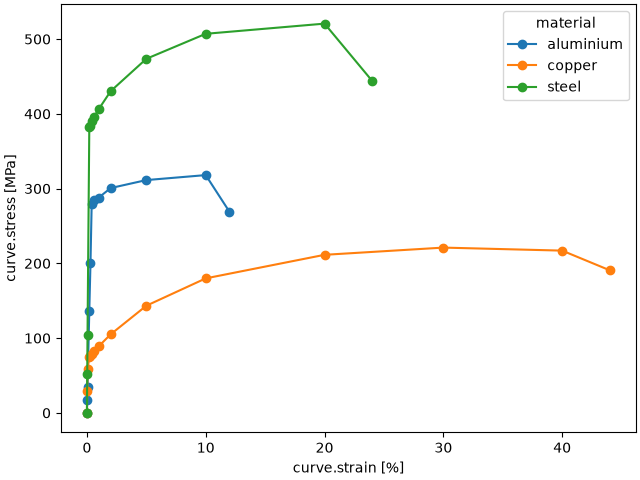
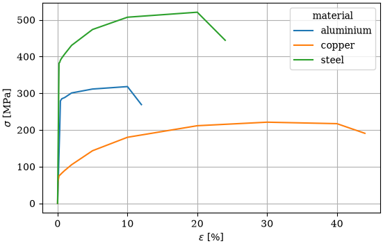
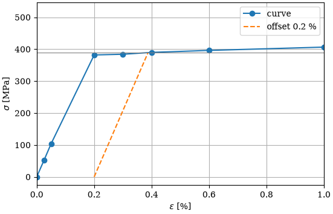
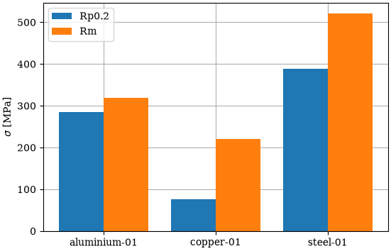

{.sk-home}
# SampleKit

**Sample data in plain Markdown: computed, current, tracked.**

Every experimental project ends up with the same questions. Which value was
computed from which measurement? Was this table made before or after the
thickness was measured again? Is the figure in the draft still right?
Spreadsheets cannot answer them, and a database keeps your data in a format
that only its own software can read.

With SampleKit, each sample is one Markdown file that you can open in any
editor, and the answers come with it:

- **computed**: the values that derive from your measurements are computed
  by formulas you write in Python;
- **current**: SampleKit knows which results still rest on the measurements
  they were computed from, and tells you which do not, and why;
- **tracked**: every change is kept in the project's history, with the
  command that made it. The history is a git repository that SampleKit runs
  itself: you need neither to install git nor to use it.

## At a glance

| To… | See |
| --- | --- |
| keep each sample in a file you can read anywhere | [Samples and projects](#samples-and-projects), [files](#files) |
| compute values with formulas you write in Python | [The model](#the-model-what-a-sample-holds), [values computed from others](#values-computed-from-others) |
| know which results no longer hold, and why | [Values out of date](#values-out-of-date) |
| write tables for another program or a paper | [Tables written to files](#tables-written-to-files) |
| draw figures in one style for the whole project | [Figures](#figures) |
| see, compare and take back any change | [The history of every change](#the-history-of-every-change) |
| work from a full-screen view, or from Python | [The terminal interface](guides/terminal-interface.md), [Python](#python) |

## Install

SampleKit is a command line, `samplekit`, and a Python package of the same
name. With Rust installed, cargo builds the command line on any system; then,
in a folder of your own, `init` makes it a project, with its own Python
environment holding the package, where your formulas run:

```bash
cargo install samplekit --locked --version 1.0.0-rc.2
samplekit init --write
```

[Install SampleKit](guides/install.md) gives each step, on Linux, macOS and
Windows: without Rust, from a release's archive; and the package by pip or
uv, into an environment of your own.

## What SampleKit guarantees

- **Reading computes nothing.** Values are computed when you ask, never as a
  side effect of looking at them.
- **Nothing is written without a preview.** Every command that changes a file
  shows the change first; `--write` confirms it.
- **Your note is yours.** The text below the data is never rewritten, unless
  you ask: `set note=…` replaces it.
- **A failure stays visible.** A formula that fails is marked as failed, with
  its error: its old number is never passed off as current, and a file written
  from it says so, and ends with an error.
- **Plain files, always.** No database, no binary format: if SampleKit
  disappeared tomorrow, your data would still be readable.

## Samples and projects

The rest of this page builds one example, a step at a time: a few material
specimens, tested in tension. SampleKit carries it as a **demo** in five
steps, each a project to try the commands on: `samplekit` alone opens the
start page, where `g`, then *The demo*, writes it and opens its first step.

### One sample, one file

A sample is a Markdown file. At the top, between the `---` lines, are its
data; below is a free note, which SampleKit keeps as you wrote it ([the file's
format](reference/sample-files.md)):

```{code-block} sample
:caption: samples/steel-01.md

---
schema_version: 1
name: steel-01
material: steel
grade: S355
direction: L
tested: 2026-03-04
properties:
  width: {v: 12.51, unit: mm}
  thickness: {v: 2.0, unit: mm}
---
Tested at 2 mm/min, along the rolling direction.
```

`material`, `grade`, `direction` and `tested` are **attributes**: free facts
about the sample. `width` and `thickness` are **properties**: what was
measured, with a value `v` and a unit ([samples and their
files](concepts/samples-and-files.md)). A sample may also carry
**tags**, `tags: [reference, rerun]`, words that group samples across their
attributes: `samplekit tag add` writes them, and a filter selects by them.
Being plain text, the file opens in any editor, and fits wherever text does: a
note-taking app, a synchronised folder, or a git repository if you use one.

### A project: a folder of samples

A **project** is a folder holding such files, and a `.samplekitrc` that marks
it as one ([projects](concepts/projects.md)):

```text
tensile-tests/
├── .samplekitrc          marks the folder as a project
└── samples/
    ├── aluminium-01.md   one file per sample
    ├── copper-01.md
    └── steel-01.md
```

`.samplekitrc` is where the project's settings will go. For now it holds one
line, the version of SampleKit's format the project is written in:

```{code-block} toml
:caption: .samplekitrc

schema_version = 1
```

### Reading them: lists, columns, filters

That is all SampleKit needs. From the project's folder, `samplekit .` lists
the samples:

```{code-block} console
:caption: ~/tensile-tests

$ samplekit .
samples/aluminium-01.md
samples/copper-01.md
samples/steel-01.md
```

A command reads from left to right: `samplekit`, the program; then what to
read. `.` is the folder you are in, read with every folder below it,
`samples/` here; a command that names no folder reads the same. A folder or a
file named, such as `samples/steel-01.md`, is read alone ([which folders a
command reads](concepts/projects.md#which-folders-a-command-reads)). Given
nothing else, it lists the samples' files, one per line.

`samplekit` alone, with nothing after it, opens the [terminal
interface](guides/terminal-interface.md): a full-screen view of the same samples, where
what this page does with commands is done with the keyboard. It lists and
filters the samples, opens one, changes a value, computes, draws a figure,
runs a script and reads the history.

Name **columns** with `-c`, by the names the files use, and the list becomes
a table:

```{code-block} console
:caption: ~/tensile-tests

$ samplekit -c material,grade,width,thickness
name           material    grade     width [mm]   thickness [mm]
────────────────────────────────────────────────────────────────
aluminium-01   aluminium   6061-T6        12.50             1.99
copper-01      copper      C11000         12.50             2.00
steel-01       steel       S355           12.51             2.00

3 of 3 samples
```

`name` was not asked for: in a terminal, SampleKit adds it first, dimmed, so
that each row says which sample it is. In a pipe or a file, a table holds only
the columns asked for, and `-c name,…` asks for it. `[render] identify` in
`.samplekitrc` adds the file's name instead, or nothing ([the
setting](reference/configuration.md#render)). The units come from the files.

A **filter** selects the samples you ask about:

```{code-block} console
:caption: ~/tensile-tests

$ samplekit -f 'material == aluminium || direction == T' -c material,direction
name           material    direction
────────────────────────────────────
aluminium-01   aluminium   L
copper-01      copper      T

2 of 3 samples
```

`-f` takes a condition written with the fields' names: `==`, `!=`, `<`, `>`,
`&&` for *and*, `||` for *or*, `!` for *not*, and words such as `has` or
`is missing` ([filters](reference/filters.md)). Here, the aluminium specimens,
and those cut across the rolling direction, `T`. The quotes keep the shell
from reading `||` itself.

`-s` sorts by a field, a `-` before it for the highest first; `-f 'tags has
reference'` would select the samples tagged `reference`:

```{code-block} console
:caption: ~/tensile-tests

$ samplekit -c material,width -s -width
name           material    width [mm]
─────────────────────────────────────
steel-01       steel            12.51
aluminium-01   aluminium        12.50
copper-01      copper           12.50

3 of 3 samples
```

### Checking them

`validate` reads every file and says what is wrong in it, before a table or a
formula reads it wrong: a file that does not read, a unit that contradicts the
others, a value outside the range the project declares. Here, a fourth
specimen whose width was typed in centimetres:

```{code-block} console
:caption: ~/tensile-tests

$ samplekit validate
  copper-02              width: two units — mm on 3, cm on 1

4 samples · 1 defect · 0 notes
error: 1 defect in 1 file
```

That specimen was a trial, and its file is removed, `samplekit
samples/copper-02.md remove --write`: the rest of this page goes on with the
three specimens. It exits with an error
while a defect remains, so that a script or a continuous integration job
stops there ([check a project in continuous
integration](guides/continuous-integration.md)).

## The model: what a sample holds

Everything so far works without anything more. But keeping a project by hand
is not what SampleKit is for: a spreadsheet does that well enough. SampleKit
starts to work for you once it knows what a sample is.

That is the **model**: a Python class, in a file beside the samples, that
declares what a specimen holds and in which units ([a model and its
formulas](concepts/models-and-formulas.md)):

```{code-block} python
:caption: model/specimen.py

import samplekit as sk


class Specimen(sk.Sample):
    """A tensile specimen: what it holds, and in which units."""

    def __init__(self, path=None, name=None):
        super().__init__(path, name=name)

        # Measured with a micrometer.
        self.width = sk.Property(unit="mm")
        self.thickness = sk.Property(unit="mm")
```

The project's `.samplekitrc` names it, in a `[model]` section: the file, the
class in it, and the Python environment that runs it (a folder made with
`python -m venv`, holding the `samplekit` package).

```{code-block} toml
:caption: .samplekitrc
:emphasize-lines: 3-6

schema_version = 1

[model]
path = "model/specimen.py"
class = "Specimen"
python = ".venv"
```

SampleKit can also write the files for you. `new` creates a sample in the
folder you name, with its fields given as `field=value`, and `set` changes the
fields of an existing one, as in `samplekit samples/steel-01.md set
thickness=2.01` ([`new`](reference/cli.md#samplekit-new) and
[`set`](reference/cli.md#samplekit-set) in the reference). Now that the model
declares the width and the thickness in millimetres, a value given this way is
written with its unit, rather than as a bare number:

```{code-block} console
:caption: ~/tensile-tests

$ samplekit samples new steel-03 material=steel width=12.5 thickness=2.0
samples/steel-03.md · new sample

  material    —  →  steel
  width       —  →  12.5 mm
              a property model/specimen.py declares
  thickness   —  →  2 mm
              a property model/specimen.py declares

apply these changes? [y/N] n
nothing written
```

Like every command that changes a file, `new` first shows what it would write
and asks before writing. Here the answer was *no*, so nothing was written. `samplekit validate` checks every
file against the model: a thickness
written `thin`, rather than a number, is a defect. And the model is where the
formulas will go, as the next sections show.

## Readings and their statistics

The width and the thickness are not known exactly: each was measured three
times with a micrometer, and the values written so far were means worked out
by hand. Write instead what was read, in place of each value, in every
sample:

```{code-block} sample
:caption: samples/steel-01.md
:emphasize-lines: 4-5

---
# … the attributes, as above …
properties:
  width: {readings: [12.494, 12.528, 12.518], unit: mm}
  thickness: {readings: [1.995, 2.004, 2.008], unit: mm}
---
Tested at 2 mm/min, along the rolling direction.
```

and say, in the model, how readings give a value ([readings and their
statistic](concepts/readings-and-statistics.md)):

```{code-block} python
:caption: model/specimen.py
:emphasize-lines: 10-21

import samplekit as sk


class Specimen(sk.Sample):
    """A tensile specimen: what it holds, and in which units."""

    def __init__(self, path=None, name=None):
        super().__init__(path, name=name)

        # Measured three times with a micrometer: the value is the mean of the
        # readings, and the uncertainty their standard error.
        self.width = sk.Property(
            unit="mm",
            value=sk.stats.mean,
            uncertainty=sk.stats.standard_error,
        )
        self.thickness = sk.Property(
            unit="mm",
            value=sk.stats.mean,
            uncertainty=sk.stats.standard_error,
        )
```

The files now hold the readings and no value: the means written by hand are
gone, and the model's are not taken yet, since reading the files computes
nothing. Until you ask, the width and the thickness are empty:

```{code-block} console
:caption: ~/tensile-tests

$ samplekit -c width,thickness
name           width   thickness
────────────────────────────────
aluminium-01   —       —
copper-01      —       —
steel-01       —       —

3 of 3 samples
```

`samplekit compute` runs the model's formulas, here the mean and its standard
error. It asks first whether to compute, then shows the results and asks
whether to write them:

```{code-block} console
:caption: ~/tensile-tests

$ samplekit compute
model  model/specimen.py
sample         value       state
─────────────────────────────────────────
aluminium-01   width       never computed
aluminium-01   thickness   never computed
copper-01      width       never computed
copper-01      thickness   never computed
steel-01       width       never computed
steel-01       thickness   never computed

6 values in 3 samples would be computed — --write computes and writes without asking
compute these 6 values? [y/N] y

  ✓ aluminium-01  width
  ✓ aluminium-01  thickness
  ✓ copper-01     width
  ✓ copper-01     thickness
  ✓ steel-01      width
  ✓ steel-01      thickness

aluminium-01
value       before                 after
────────────────────────────────────────
width       —        12.5027 ± 0.0038 mm
thickness   —         1.9933 ± 0.0078 mm
copper-01
value       before                 after
────────────────────────────────────────
width       —        12.5043 ± 0.0033 mm
thickness   —         1.9967 ± 0.0056 mm
steel-01
value       before                 after
────────────────────────────────────────
width       —        12.513 ± 0.011 mm
thickness   —         2.0023 ± 0.0039 mm

computed 6 values in 3 samples

apply these changes? [y/N] y
written: 3 files
  samples/aluminium-01.md
  samples/copper-01.md
  samples/steel-01.md
```

**`--write`** answers both questions in advance: it computes and writes at
once. Every command that changes a file works this way: without `--write`, it
shows the change and asks first. Keep `--write` for when you already know what
will change.

Every value now has its uncertainty:

```{code-block} console
:caption: ~/tensile-tests

$ samplekit -c width,thickness
name               width [mm]    thickness [mm]
───────────────────────────────────────────────
aluminium-01   12.503 ± 0.004   1.9933 ± 0.0078
copper-01      12.504 ± 0.004   1.9967 ± 0.0056
steel-01       12.513 ± 0.011   2.0023 ± 0.0039

3 of 3 samples
```

Where no precision is declared, an uncertainty is shown to two significant
digits, and its value to the same decimal place, as the GUM (the international
guide to measurement uncertainty) recommends; declaring one is shown further
on ([values and their uncertainty](concepts/values-and-uncertainty.md)). In a column, SampleKit may drop the second digit so that every row
has the same decimals: `0.0038` is shown `0.004` beside `0.010`. An
uncertainty that starts with a 1 always keeps two digits: rounded to one,
`0.014` would lose almost a third of itself. Only the display is rounded: the
file keeps every digit.

```{code-block} sample
:caption: samples/steel-01.md
:emphasize-lines: 4-19

---
# … the attributes, as above …
properties:
  width:
    v: 12.513333333333334
    readings: [12.494, 12.528, 12.518]
    u: 0.01008849730028156
    unit: mm
    statistics: {v: mean, u: standard_error}
    computed: {readings: b1b4d9b56ab1}
    fingerprint: f099c3bf0938
  thickness:
    v: 2.0023333333333335
    readings: [1.995, 2.004, 2.008]
    u: 0.003844187531556873
    unit: mm
    statistics: {v: mean, u: standard_error}
    computed: {readings: 3160016f6c6e}
    fingerprint: 1d88e7bb89d3
---
Tested at 2 mm/min, along the rolling direction.
```

The value `v` now has an uncertainty `u`, and both sit beside the readings
they come from. An uncertainty known otherwise, such as an instrument's
resolution, can also be written by hand: `{v: 12.5, u: 0.01, unit: mm}`.
`computed` and `fingerprint` are a short record of those readings: you never
write it by hand. It is how SampleKit tells, later, whether the value still
holds: if a reading is corrected, it knows ([what makes a value
current](concepts/current-and-outdated.md), [the
fingerprints](reference/fingerprints.md)).

## Values computed from others

The cross-section $A$ is the width $w$ times the thickness $t$, and its
uncertainty $u_A$ follows from theirs:

$$
A = w\,t
\qquad
u_A = \sqrt{(t\,u_w)^2 + (w\,u_t)^2}
$$

The model holds this formula, and names the values it reads:

```{code-block} python
:caption: model/specimen.py
:emphasize-lines: 1, 13-18, 20-32

import math
import samplekit as sk


class Specimen(sk.Sample):
    """A tensile specimen: what it holds, and in which units."""

    def __init__(self, path=None, name=None):
        super().__init__(path, name=name)

        # … the width and the thickness, as above …

        # The cross-section, computed from the width and the thickness.
        self.area = sk.Property(
            unit="mm²",
            compute=self._area,
            depends_on=["width", "thickness"],
        )

    def _area(self):
        """The width times the thickness, and its uncertainty from theirs."""
        w = self.width
        t = self.thickness
        value = w.value * t.value
        # A size typed without its readings has no uncertainty: nor has the area.
        if w.uncertainty is None or t.uncertainty is None:
            return value
        uncertainty = math.sqrt(
            (t.value * w.uncertainty) ** 2
            + (w.value * t.uncertainty) ** 2
        )
        return value, uncertainty
```

`area` is a property like the width, with two more keywords:

- `compute` names the method that gives it. Here `_area` returns the value
  and its uncertainty together, as a pair; a method that returns a number
  alone gives a value without uncertainty. Two other keywords split the work
  when that is clearer: `compute_value` for the value alone, beside an
  uncertainty given another way, and `compute_uncertainty` for the uncertainty
  alone, such as an instrument rated at 0.5 % of its reading.
- `depends_on` names what the formula reads. SampleKit uses it to compute the
  width and the thickness before the area, and to know that the area is out of
  date as soon as one of them changes. It cannot see inside the method: a
  value read and left out of `depends_on` would never make the area out of
  date.

[A model and its formulas](concepts/models-and-formulas.md) says more,
and the Python reference lists every keyword of
{py:class}`sk.Property <samplekit.Property>`.

`samplekit compute --write` computes the area and writes it, with its record.
The table then shows it beside the width and the thickness:

```{code-block} console
:caption: ~/tensile-tests

$ samplekit -c width,thickness,area
name               width [mm]    thickness [mm]       area [mm²]
────────────────────────────────────────────────────────────────
aluminium-01   12.503 ± 0.004   1.9933 ± 0.0078   24.922 ± 0.098
copper-01      12.504 ± 0.004   1.9967 ± 0.0056   24.967 ± 0.070
steel-01       12.513 ± 0.011   2.0023 ± 0.0039   25.056 ± 0.053

3 of 3 samples
```

`explain` says where a value comes from: what it was computed from, each with
its state, and whether it still holds:

```{code-block} console
:caption: ~/tensile-tests

$ samplekit samples/steel-01.md explain area
steel-01 · area = 25.056 ± 0.053 mm²

  computed from
    thickness        2.0023 ± 0.0039 mm  current
    width            12.513 ± 0.011 mm   current

  this value is current
```

## A table inside a sample

### In the sample's file

A tensile test pulls the specimen until it breaks. At each step, it reads the
**strain**, how much longer the specimen has become in %, and the **force**.
These points form a curve, which the file holds as a **table**, below the
properties. The table first names its **index**, the column whose values
identify the rows (here the strain), then lists its columns, then holds one
row per point ([tables in a file](reference/sample-files.md#tables)):

```{code-block} sample
:caption: samples/steel-01.md
:emphasize-lines: 5-24

---
# … the attributes, as above …
properties:
  # … width, thickness and area, as computed above …
tables:
  curve:
    index: strain
    columns:
      strain: {unit: "%"}
      force: {unit: kN}
    rows:
      - {strain: 0, force: 0.0}
      - {strain: 0.025, force: 1.281}
      - {strain: 0.05, force: 2.585}
      - {strain: 0.2, force: 9.516}
      - {strain: 0.3, force: 9.57}
      - {strain: 0.4, force: 9.716}
      - {strain: 0.6, force: 9.87}
      - {strain: 1, force: 10.128}
      - {strain: 2, force: 10.724}
      - {strain: 5, force: 11.802}
      - {strain: 10, force: 12.636}
      - {strain: 20, force: 12.975}
      - {strain: 24, force: 11.07}
---
Tested at 2 mm/min, along the rolling direction.
```

`view` shows a sample whole, its tables unfolded:

```{code-block} console
:caption: ~/tensile-tests

$ samplekit samples/steel-01.md view
steel-01
  tags        —
  material    steel
  grade       S355
  direction   L
  tested      2026-03-04
  width       12.513 ± 0.011 mm
              readings 12.494, 12.528, 12.518
  thickness   2.0023 ± 0.0039 mm
              readings 1.995, 2.004, 2.008
  area        25.056 ± 0.053 mm²

  curve · 13 rows
  strain [%]   force [kN]
  ───────────────────────
       0.000        0.000
       0.025        1.281
       0.050        2.585
       0.200        9.516
       0.300        9.570
       0.400        9.716
       0.600        9.870
       1.000       10.128
       2.000       10.724
       5.000       11.802
      10.000       12.636
      20.000       12.975
      24.000       11.070
```

### A column computed row by row

The **stress** is the force divided by the cross-section, $\sigma = F / A$.
There is one stress per row, not one per sample: it is a column of the table,
computed row by row.

The model declares the table with `sk.Table`: its columns, then its index.
Each column is an `sk.Property`, as in the rest of the model, and takes the same
keywords: a unit, and for a computed column `compute` and `depends_on`.

```{code-block} python
:caption: model/specimen.py
:emphasize-lines: 9-22, 26-28

class Specimen(sk.Sample):
    """A tensile specimen: what it holds, and in which units."""

    def __init__(self, path=None, name=None):
        super().__init__(path, name=name)

        # … the width, the thickness and the area, as above …

        # The test: the force read at each strain, and the stress computed
        # in each row from that row's force and the cross-section.
        self.curve = sk.Table(
            {
                "strain": sk.Property(unit="%"),
                "force": sk.Property(unit="kN"),
                "stress": sk.Property(
                    unit="MPa",
                    compute=self._stress,
                    depends_on=["row.force", "area"],
                ),
            },
            index="strain",
        )

    # … _area, as above …

    def _stress(self, row):
        """The force over the cross-section: kN over mm², times 1000, is MPa."""
        return 1000 * row.force.value / self.area.value
```

The only difference with a property is what the method is given. The area's
method, `_area`, takes nothing but `self`, the sample. The stress's method,
`_stress`, also takes `row`, and runs once for each row: `row.force` is the
force of that row, and `self.area` the area of the sample, the same in every
row. `depends_on` names them the same way: `row.force` for the force of the
same row, `area` for the sample's property ([formulas over a
table](concepts/models-and-formulas.md#formulas-over-a-table)).

The stress has no uncertainty here, so nothing says how many digits it
deserves. The project says it in `.samplekitrc`, as a **precision**, written
as in Python's format strings: `.1f` writes one decimal, `.2e` two in
scientific notation ([how many
digits](concepts/values-and-uncertainty.md#precision-how-many-digits)).

```{code-block} toml
:caption: .samplekitrc
:emphasize-lines: 3-4

# … schema_version and [model], as above …

[property."curve.stress"]
precision = ".1f"
```

`compute --write` then fills the column, in every sample:

```{code-block} console
:caption: ~/tensile-tests

$ samplekit compute --write
model  model/specimen.py
  ✓ aluminium-01  curve.stress
  ✓ copper-01     curve.stress
  ✓ steel-01      curve.stress

curve.stress
sample         before    after
──────────────────────────────
aluminium-01   —        12 new
copper-01      —        15 new
steel-01       —        13 new

computed 40 values in 3 samples
written: 3 files
  samples/aluminium-01.md
  samples/copper-01.md
  samples/steel-01.md
```

```{code-block} console
:caption: ~/tensile-tests

$ samplekit samples/steel-01.md view
steel-01
  tags        —
  material    steel
  grade       S355
  direction   L
  tested      2026-03-04
  width       12.513 ± 0.011 mm
              readings 12.494, 12.528, 12.518
  thickness   2.0023 ± 0.0039 mm
              readings 1.995, 2.004, 2.008
  area        25.056 ± 0.053 mm²

  curve · 13 rows
  strain [%]   force [kN]   stress [MPa]
  ──────────────────────────────────────
       0.000        0.000            0.0
       0.025        1.281           51.1
       0.050        2.585          103.2
       0.200        9.516          379.8
       0.300        9.570          381.9
       0.400        9.716          387.8
       0.600        9.870          393.9
       1.000       10.128          404.2
       2.000       10.724          428.0
       5.000       11.802          471.0
      10.000       12.636          504.3
      20.000       12.975          517.8
      24.000       11.070          441.8
```

## Results computed from a table

### Four results from the curve

Four results are read on the curve:

- the **Young's modulus** `E`, the slope of the curve's straight first part. A
  line is fitted to the rows up to 0.05 % of strain, and the uncertainty of `E`
  is that of its slope;
- the **yield strength** `Rp0.2`, where the metal starts to stretch for good.
  It is the stress where the curve crosses that same line, moved 0.2 % to the
  right;
- the **tensile strength** `Rm`, the highest stress;
- the **elongation** `A`, the strain at the break.

Each is a property of the sample, computed from whole columns of the table. In
`depends_on`, `curve.strain` and `curve.stress` name these columns, where
`row.force` named a single cell of a row. The methods read them with
`self.curve.values(...)`:

```{code-block} python
:caption: model/specimen.py
:emphasize-lines: 9-29, 33-73

class Specimen(sk.Sample):
    """A tensile specimen: what it holds, and in which units."""

    def __init__(self, path=None, name=None):
        super().__init__(path, name=name)

        # … the width, the thickness, the area and the curve, as above …

        # What the curve gives.
        self.young_modulus = sk.Property(
            unit="GPa",
            compute=self._young_modulus,
            depends_on=["curve.strain", "curve.stress"],
        )
        self.yield_strength = sk.Property(
            unit="MPa",
            compute=self._yield_strength,
            depends_on=["curve.strain", "curve.stress", "young_modulus"],
        )
        self.tensile_strength = sk.Property(
            unit="MPa",
            compute=self._tensile_strength,
            depends_on=["curve.stress"],
        )
        self.elongation = sk.Property(
            unit="%",
            compute=self._elongation,
            depends_on=["curve.strain"],
        )

    # … _area and _stress, as above …

    def _young_modulus(self):
        """The slope of a straight line fitted to the rows up to 0.05 %, and
        the uncertainty of that slope."""
        points = [
            (strain, stress)
            for strain, stress in zip(self.curve.values("strain"), self.curve.values("stress"))
            if strain <= 0.05
        ]
        n = len(points)
        mean_strain = sum(strain for strain, _ in points) / n
        mean_stress = sum(stress for _, stress in points) / n
        spread = sum((strain - mean_strain) ** 2 for strain, _ in points)
        slope = sum(
            (strain - mean_strain) * (stress - mean_stress) for strain, stress in points
        ) / spread
        residuals = [
            stress - mean_stress - slope * (strain - mean_strain) for strain, stress in points
        ]
        uncertainty = math.sqrt(sum(r * r for r in residuals) / (n - 2) / spread)
        # MPa per % of strain, to GPa: times 100, then divided by 1000.
        return slope / 10, uncertainty / 10

    def _yield_strength(self):
        """Where the curve crosses the straight line of slope E, moved 0.2 %
        to the right: interpolated between the two rows on either side."""
        slope = self.young_modulus.value * 10  # GPa to MPa per %
        rows = list(zip(self.curve.values("strain"), self.curve.values("stress")))
        for (e0, s0), (e1, s1) in zip(rows, rows[1:]):
            above0 = s0 - slope * (e0 - 0.2)
            above1 = s1 - slope * (e1 - 0.2)
            if above0 > 0 >= above1:
                return s0 + above0 / (above0 - above1) * (s1 - s0)
        return None

    def _tensile_strength(self):
        """The highest stress."""
        return max(self.curve.values("stress"))

    def _elongation(self):
        """The strain at the break: the last row."""
        return self.curve.values("strain")[-1]
```

### Their precision

`E` has an uncertainty, so it is shown to that uncertainty, as the width is.
`Rp0.2`, `Rm` and `A` have none: each needs a precision, as the stress did:

```{code-block} toml
:caption: .samplekitrc
:emphasize-lines: 3-10

# … schema_version, [model] and [property."curve.stress"], as above …

[property.yield_strength]
precision = ".0f"

[property.tensile_strength]
precision = ".0f"

[property.elongation]
precision = ".1f"
```

`samplekit compute --write` then computes the four results of each specimen,
which a table shows:

```{code-block} console
:caption: ~/tensile-tests

$ samplekit -c young_modulus,yield_strength,tensile_strength,elongation
name           young_modulus [GPa]   yield_strength [MPa]   tensile_strength [MPa]   elongation [%]
───────────────────────────────────────────────────────────────────────────────────────────────────
aluminium-01            69.2 ± 0.3                    285                      318             12.0
copper-01              117.2 ± 0.9                     76                      221             44.0
steel-01               206.3 ± 1.1                    387                      518             24.0

3 of 3 samples
```

## Profiles and summaries

Rather than typing the same columns each time, a **profile** saves them in
`.samplekitrc`, with labels and a sort order ([queries, profiles and
groups](concepts/projects.md#queries-profiles-and-groups)):

```{code-block} toml
:caption: .samplekitrc
:emphasize-lines: 3-12

# … as above …

[profile.overview]
columns = [
  {field = "name"},
  {field = "material"},
  {field = "young_modulus", label = "E", precision = ".1f"},
  {field = "yield_strength", label = "Rp0.2"},
  {field = "tensile_strength", label = "Rm"},
  {field = "elongation", label = "A"},
]
sort = ["material", "name"]
```

`--profile overview` then stands for all of it:

```{code-block} console
:caption: ~/tensile-tests

$ samplekit --profile overview
name           material        E [GPa]   Rp0.2 [MPa]   Rm [MPa]   A [%]
───────────────────────────────────────────────────────────────────────
aluminium-01   aluminium    69.2 ± 0.3           285        318    12.0
copper-01      copper      117.2 ± 0.9            76        221    44.0
steel-01       steel       206.3 ± 1.1           387        518    24.0

3 of 3 samples
```

A filter used often is saved too, as a **query**: `[query.ductile]` with
`filter = "elongation > 20"` in `.samplekitrc`. `--query` then selects with
it, beside a profile or anything else:

```{code-block} console
:caption: ~/tensile-tests

$ samplekit --query ductile --profile overview
name        material       E [GPa]   Rp0.2 [MPa]   Rm [MPa]   A [%]
───────────────────────────────────────────────────────────────────
copper-01   copper     117.2 ± 0.9            76        221    44.0
steel-01    steel      206.3 ± 1.1           387        518    24.0

2 of 3 samples
```

And a summary. The three specimens were cut to the same size, 12.5 by 2 mm:
how close did they come?

```{code-block} console
:caption: ~/tensile-tests

$ samplekit -c width,thickness --summary
                 n     mean (1/u²)        s      sem    median       min       max
──────────────────────────────────────────────────────────────────────────────────
width [mm]       3/3       12.5042   0.0057   0.0025   12.504    12.503    12.513
thickness [mm]   3/3        1.9995   0.0046   0.0030    1.9967    1.9933    2.0023
```

`--summary` gives each column's statistics instead of its rows: the count `n`,
the mean, the standard deviation `s`, the standard error of that mean `sem`,
the median, the minimum and the maximum. Where the values carry an
uncertainty, the mean is weighted by $1/u_i^2$ and `sem` is
$1/\sqrt{\sum_i 1/u_i^2}$; otherwise `sem` is $s/\sqrt{n}$. An `s` far above
`sem` says the values scatter more than their uncertainties allow.
`--group material` would take them material by material.

## Tables written to files

Every table shown so far can also go to a file. `-o` names the file, and its
extension says what to write in it: a data file for another program, or a
table to paste into a document.

A file writes each number as the table shows it, at the precision declared for
its property or its column. A precision is kept as you give it, for the
uncertainty too, which is rounded up, never understated: `.1f` writes an
uncertainty of 0.012 as `0.1`, eight times its size. A pair gives
each its own, `precision = [".1f", ".2g"]`: one decimal for the value, two
significant digits for its uncertainty. The profile `overview` gives `E` a
precision of its own, `.1f`: its uncertainty, about 1 GPa, is written `1.1`.

### Data files, for another program

A **data file**, `.csv`, `.tsv` or `.json`, holds the numbers for a
spreadsheet, a script or a plotting tool. A value and its uncertainty take two
columns, each headed with its unit, and named after the field rather than
after the profile's label: `young_modulus`, not `E`. A column with no
uncertainty in any sample gets no uncertainty column, and a note says so:

```{code-block} console
:caption: ~/tensile-tests

$ samplekit --profile overview -o overview.csv --write
note: yield_strength_uncertainty is left out: it is empty for every sample
note: tensile_strength_uncertainty is left out: it is empty for every sample
note: elongation_uncertainty is left out: it is empty for every sample
written: overview.csv
```

```{code-block} text
:caption: overview.csv

name,material,young_modulus_value [GPa],young_modulus_uncertainty [GPa],yield_strength_value [MPa],tensile_strength_value [MPa],elongation_value [%]
aluminium-01,aluminium,69.2,0.3,285,318,12.0
copper-01,copper,117.2,0.9,76,221,44.0
steel-01,steel,206.3,1.1,387,518,24.0
```

Another program often needs every digit rather than those a reader is shown.
`.17g`, up to seventeen significant digits, is every digit a number carries:
`--precision .17g` writes them all, for one file. A profile meant for files
says it once, column by column: `precision` sets the digits, and `header`
names the column in the file ([every key of a
column](reference/configuration.md#profilename)):

```{code-block} toml
:caption: .samplekitrc

[profile.data]
columns = [
  {field = "name"},
  {field = "young_modulus", header = "E", precision = ".17g"},
  {field = "yield_strength", header = "Rp0.2", precision = ".17g"},
]
```

```{code-block} console
:caption: ~/tensile-tests

$ samplekit --profile data -o data.csv --write
note: Rp0.2_uncertainty is left out: it is empty for every sample
written: data.csv
```

```{code-block} text
:caption: data.csv

name,E_value [GPa],E_uncertainty [GPa],Rp0.2_value [MPa]
aluminium-01,69.17587793087974,0.27799567339783,285.0245062817296
copper-01,117.19476480206947,0.8787328442349305,75.8774024282937
steel-01,206.33891963549178,1.0599559413170074,387.0497568958748
```

### Documents: LaTeX, Markdown, HTML

A **document**, `.tex`, `.md` or `.html`, holds a table to paste into a paper,
a report or a web page. How each value is written in it depends on a
**style**, and SampleKit provides one for each of the three. The LaTeX style
writes a value and its uncertainty in maths, `$69.2 \pm 0.3$`, and puts the
units in the headers:

```{code-block} console
:caption: ~/tensile-tests

$ samplekit --profile overview -o overview.tex --write
written: overview.tex
```

```{code-block} latex
:caption: overview.tex

\begin{tabular}{llrrrr}
\toprule
name & material & E (GPa) & Rp0.2 (MPa) & Rm (MPa) & A (\%) \\
\midrule
aluminium-01 & aluminium & $69.2 \pm 0.3$ & 285 & 318 & 12.0 \\
copper-01 & copper & $117.2 \pm 0.9$ & 76 & 221 & 44.0 \\
steel-01 & steel & $206.3 \pm 1.1$ & 387 & 518 & 24.0 \\
\bottomrule
\end{tabular}
```

A `[style.latex]` section in `.samplekitrc` changes what you need ([every key
of a style](reference/configuration.md#stylename)). For instance, to write each
value with the `\num` command of the `siunitx` package, add:

```{code-block} toml
:caption: .samplekitrc

[style.latex]
property = '\num{{value} \pm {uncertainty}}'
```

Each cell then reads `\num{69.2 \pm 0.3}`.

### Exports: written again by one command

A table for a paper is made more than once: when a sample is added, or a
measurement redone. An **export** declared in `.samplekitrc` names the
profile, the style and the file ([every key of an
export](reference/configuration.md#exportname)):

```{code-block} toml
:caption: .samplekitrc

[export.paper]
profile = "overview"
style = "latex"
output = "paper/results.tex"
```

One command then writes the file again, as often as needed:

```{code-block} console
:caption: ~/tensile-tests

$ samplekit export paper --write
export paper · paper/results.tex · 3 rows
written: paper/results.tex, 3 rows
```

Months later, `samplekit paper/results.tex explain` says whether the file
still matches the samples, and how to make it again as it was ([an export for
a paper](guides/export-for-a-paper.md)).

Results do not stay as they are: a measurement is redone, a sample added, a
formula corrected. The rest of this page shows what SampleKit does then.

## Values out of date

The thickness of `steel-01` is measured again. `set` replaces its three
readings in the file. Before writing, it shows the change, then every value
the change makes out of date, with the reason:

```{code-block} console
:caption: ~/tensile-tests

$ samplekit samples/steel-01.md set thickness.readings=1.991,1.994,1.989 --write
samples/steel-01.md · 1 change

  thickness.readings   1.995, 2.004, 2.008  →  1.991, 1.994, 1.989
                       3 readings: 1.991, 1.994, 1.989, their mean 1.9913
                       they replace the 3 readings it held
                       its value and its uncertainty, their mean and standard error, wait for samplekit compute

  this makes 18 values not current
    area               outdated — thickness
    tensile_strength   outdated — curve.stress (itself not current)
    thickness          outdated — readings
    yield_strength     outdated — young_modulus (itself not current), curve.stress (itself not current)
    young_modulus      outdated — curve.stress (itself not current)
    curve.stress       outdated — area (itself not current) (13 rows)

  samplekit samples/steel-01.md compute --write recomputes them

written: samples/steel-01.md
```

### Marked in a table

Nothing is computed yet. Until it is, a table marks each value out of date
with `⚠`, beside its number:

```{code-block} console
:caption: ~/tensile-tests

$ samplekit -c thickness,area,young_modulus
name              thickness [mm]         area [mm²]   young_modulus [GPa]
─────────────────────────────────────────────────────────────────────────
aluminium-01   1.9933 ± 0.0078     24.922 ± 0.098            69.2 ± 0.3
copper-01      1.9967 ± 0.0056     24.967 ± 0.070           117.2 ± 0.9
steel-01       2.0023 ± 0.0039 ⚠   25.056 ± 0.053 ⚠         206.3 ± 1.1 ⚠

3 of 3 samples
```

`samplekit status` lists every value that is not current in the project,
with the reason. In a table, `--status` adds the same as a column of words,
`state`, row by row.

### Said in a file

A mark never leaves the terminal: in a file, a program would read `⚠` as part
of the number. A data file gets a column of words instead, beside each
quantity with a value out of date. The command lists those values and, as
every file written from values out of date does, ends with an error, so that a
script stops there; `--accept outdated` names the state to let through:

```{code-block} console
:caption: ~/tensile-tests

$ samplekit -c name,yield_strength,tensile_strength -o redone.csv --write
note: yield_strength_uncertainty is left out: it is empty for every sample
note: tensile_strength_uncertainty is left out: it is empty for every sample
the table is written from values that are not current: 2 outdated in 1 sample
steel-01 tensile_strength, steel-01 yield_strength
samplekit status says why, and compute --write brings them up to date
written: redone.csv
error: redone.csv is written from values not current — --accept outdated exits 0 for it
```

```{code-block} text
:caption: redone.csv

name,yield_strength_value [MPa],yield_strength_state,tensile_strength_value [MPa],tensile_strength_state
aluminium-01,285,,318,
copper-01,76,,221,
steel-01,387,outdated,518,outdated
```

A document has no place for such a column. `export` writes it from the
values as they stand, says which are not current, and ends with the same
error, so that a script writing the paper stops there:

```{code-block} console
:caption: ~/tensile-tests

$ samplekit export paper --write
export paper · paper/results.tex · 3 rows
'paper' is written from values that are not current: 3 outdated in 1 sample
steel-01 tensile_strength, steel-01 yield_strength, steel-01 young_modulus
the file is written as they stand — samplekit samples compute --write brings them up to date
written: paper/results.tex, 3 rows
error: paper/results.tex is written from values not current — --accept outdated exits 0 for it
```

### Computed again

`compute --write` computes the values out of date again, in order, and shows
what moved:

```{code-block} console
:caption: ~/tensile-tests

$ samplekit compute --write
model  model/specimen.py
  ✓ steel-01      thickness
  ✓ steel-01      area
  ✓ steel-01      curve.stress
  ✓ steel-01      young_modulus
  ✓ steel-01      yield_strength
  ✓ steel-01      tensile_strength

steel-01
value                          before                after
──────────────────────────────────────────────────────────
thickness          2.0023 ± 0.0039 mm   1.9913 ± 0.0015 mm
area               25.056 ± 0.053 mm²   24.918 ± 0.028 mm²
curve.stress                 13 cells           12 changed
young_modulus         206.3 ± 1.1 GPa      207.5 ± 1.1 GPa
yield_strength                387 MPa              389 MPa
tensile_strength              518 MPa              521 MPa

computed 18 values in 1 sample
written: samples/steel-01.md
```

Only what depends on the change is computed again. It is the same when the
change comes from a text editor, or from a formula edited in the model ([what
makes a value current](concepts/current-and-outdated.md)).

### Written by hand

A computed value can be typed over its formula: an area measured otherwise,
say. It is **edited**: `compute` keeps it, and computes again what reads it:

```{code-block} console
:caption: ~/tensile-tests

$ samplekit samples/steel-01.md set area=25.0 --write
samples/steel-01.md · 1 change

  area   24.918 ± 0.028 mm²  →  25.000 ± 0.028 mm²
         typed over its formula, which stays

  this makes 17 values not current
    area               edited — typed over its formula
    tensile_strength   outdated — curve.stress (itself not current)
    yield_strength     outdated — young_modulus (itself not current), curve.stress (itself not current)
    young_modulus      outdated — curve.stress (itself not current)
    curve.stress       outdated — area (13 rows)

  samplekit samples/steel-01.md compute --write recomputes the others; --force also gives a value typed over its formula back to it

written: samples/steel-01.md
```

`status` lists it as *edited*, and a table marks it `✎`. `--force` gives it
back to its formula:

```{code-block} console
:caption: ~/tensile-tests

$ samplekit compute --force --write
model  model/specimen.py
  ✓ steel-01      area
  ✓ steel-01      curve.stress
  ✓ steel-01      young_modulus
  ✓ steel-01      yield_strength
  ✓ steel-01      tensile_strength

steel-01
value                          before   after
──────────────────────────────────────────────────────────
area               25.000 ± 0.028 mm²   24.918 ± 0.028 mm²
curve.stress                 13 cells   unchanged
young_modulus         207.5 ± 1.1 GPa   unchanged
yield_strength                389 MPa   unchanged
tensile_strength              521 MPa   unchanged

computed 17 values in 1 sample, 16 unchanged
written: samples/steel-01.md
```

### When a formula cannot run

A fourth specimen is measured, and not yet tested: `samplekit samples new
steel-02 width.readings=… thickness.readings=…` makes it, with no curve. Its
area can be computed; what reads the curve **waits** for it, and is said so,
not computed from nothing:

```{code-block} console
:caption: ~/tensile-tests

$ samplekit compute --write
model  model/specimen.py
  ✓ steel-02      width
  ✓ steel-02      thickness
  ✓ steel-02      area
  · steel-02      young_modulus             waits for curve.strain; curve.stress
  · steel-02      yield_strength            waits for curve.strain; curve.stress; young_modulus
  · steel-02      tensile_strength          waits for curve.stress
  · steel-02      elongation                waits for curve.strain

steel-02
value       before                 after
────────────────────────────────────────
width       —        12.5000 ± 0.0058 mm
thickness   —         2.0000 ± 0.0058 mm
area        —         25.000 ± 0.074 mm²

computed 3 values in 1 sample, 4 wait for curve.strain, curve.stress
written: samples/steel-02.md
```

`explain` says what a value waits for, and how to give it:

```{code-block} console
:caption: ~/tensile-tests

$ samplekit samples/steel-02.md explain young_modulus
steel-02 · young_modulus = —

  nothing is stored here
  the model computes it from curve.strain, curve.stress
  it waits for curve.strain and curve.stress, which nobody entered here
  samplekit samples/steel-02.md set --add-row curve <column>=<value> … adds a row, then samplekit samples/steel-02.md compute --write
```

A formula that raises an error instead **fails**: its value is marked `✗`,
`explain` gives the error, and its old number is never shown as current.

## The history of every change

SampleKit keeps every change it writes in the project's **history**, with the
command that made it. The history is a git repository that SampleKit runs
itself: there is nothing to install and nothing to set up. Any `git` reads
it too, so that the project's past stays readable even without SampleKit
([reading it without
SampleKit](concepts/history.md#reading-it-without-samplekit)).

`log` lists the changes, the latest first. Given a file, it lists only those
that touched it. Here, as it stood just after the thickness was measured
again and computed, before `area` was typed by hand:

```{code-block} console
:caption: ~/tensile-tests

$ samplekit samples/steel-01.md log
#   when               what
────────────────────────────────────────────────────────────────────────────────────────────────────
1   2026-10-06 21:56   samplekit compute --write
2   2026-10-06 21:56   samplekit samples/steel-01.md set thickness.readings=1.991,1.994,1.989
                       --write
3   2026-10-06 21:56   samplekit compute --write
4   2026-10-06 21:56   the project as SampleKit first kept it
```

`diff` shows a change value by value: the latest by default, or the one
`--to` names, here the thickness measured again:

```{code-block} console
:caption: ~/tensile-tests

$ samplekit diff --to 2
from  #3 · 2026-10-06 21:56 · samplekit compute --write
to    #2 · 2026-10-06 21:56 · samplekit samples/steel-01.md set thickness.readings=1.991,1.994,1.989 --write

samples/steel-01.md
  thickness.readings   1.995, 2.004, 2.008  →  1.991, 1.994, 1.989
```

`restore` takes a change back, and `--at` reads the whole project as it was at
a given change or on a given day. Shared through your own git repository or a
synchronised folder, the history follows the project from one computer to
another ([the history](concepts/history.md), [sharing a
project](guides/share-a-project.md)).

## Figures

SampleKit draws figures with matplotlib, from the samples and by a command:
like a table, a figure is made again whenever the data changes.

### From the command line

`plot` draws a figure from the fields it is given, as `-c` gives a table's
columns. `-x` and `-y` name the field on each axis, here two columns of the
table `curve`, so that each sample gives a curve. `--kind` says how the points
are drawn: `scatter`, the default, `line`, `step`, `bar` or `box`. `--group`
draws a series per value of a field, here a colour per material. Without
`-o`, the figure opens in a window; with `-o`, it is written to a file:

```{code-block} console
:caption: ~/tensile-tests

$ samplekit plot -x curve.strain -y curve.stress --kind line --group material -o curves.png --write
figure curve.stress against curve.strain · curves.png · 3 samples
written: curves.png
```



Each axis is labelled with its field and unit, and the figure has
matplotlib's look.

### Declared by name

A figure drawn more than once is declared in `.samplekitrc` under a name, as
a profile is for a table, with the same keys as the options ([every key of a
figure](reference/configuration.md#figurename)):

```{code-block} toml
:caption: .samplekitrc
:emphasize-lines: 3-7

# … as above …

[figure.curves]
kind = "line"
x = "curve.strain"
y = "curve.stress"
group = "material"
```

Its name then stands for all of it, and draws the same figure:

```{code-block} console
:caption: ~/tensile-tests

$ samplekit plot curves -o curves.png --write
figure curves · curves.png · 3 samples
written: curves.png
```

A figure for a paper is written again at each draft, as its table is. An
export names it as `[export.paper]` names a profile: `figure` says which, and
`output` where, in the format its extension names ([every key of an
export](reference/configuration.md#exportname)):

```{code-block} toml
:caption: .samplekitrc
:emphasize-lines: 3-5

# … as above …

[export.curves]
figure = "curves"
output = "paper/curves.pdf"
```

`export` then writes it, with no `-o` to remember:

```{code-block} console
:caption: ~/tensile-tests

$ samplekit export curves --write
export curves · figure curves · paper/curves.pdf · 3 samples
written: paper/curves.pdf
```

### One style for the whole project

A paper wants its figures alike: the same font, the same size, the same
symbols. SampleKit says it once for the project, and every figure it draws
follows, the model's included.

`[matplotlib]` holds matplotlib's own settings, by their names
([`[matplotlib]`](reference/configuration.md#matplotlib)). Here, a serif font,
a grid, a size in centimetres, and curves drawn without a marker on each
point:

```{code-block} toml
:caption: .samplekitrc
:emphasize-lines: 3-7

# … as above …

[matplotlib]
"font.family" = "serif"
"axes.grid" = true
"figure.figsize" = [14, 9]
"lines.marker" = "None"
```

`style` in the same section applies matplotlib's style sheets, by name or as
a `.mplstyle` file, and `fonts` brings font files kept in the project. A
figure that should differ says so in its own declaration, `matplotlib = { … }`.
Shared by several projects, these settings can live in a file of their own,
which each project imports ([organise a project's
settings](guides/organise-settings.md)).

The labels come from a **style**, as a LaTeX table's units do
([styles](reference/configuration.md#stylename)). `[style.figure]` declares a
style for figures, and `[render] figure_style` makes it the one figures use.
Each property then gives its symbol in that style with `symbol_figure`:
between `$…$`, matplotlib writes it as mathematics. A unit is given its own
spelling the same way, under `[unit."MPa"]`, where the files' spelling does
not suit. The stress's symbol joins the section that already holds its
precision:

```{code-block} toml
:caption: .samplekitrc
:emphasize-lines: 3-9, 13

# … as above …

[style.figure]

[render]
figure_style = "figure"

[property."curve.strain"]
symbol_figure = '$\varepsilon$'

[property."curve.stress"]
precision = ".1f"
symbol_figure = '$\sigma$'
```

The same command now draws the figure in the project's look:

```{code-block} console
:caption: ~/tensile-tests

$ samplekit plot curves -o curves.png --write
figure curves · curves.png · 3 samples
written: curves.png
```



As for the table of the paper, `samplekit curves.png explain` says whether
the figure still matches the samples.

### Drawn by the model

A declared figure plots one field against another. For anything more, such as
a reference line, a fit or several panels, the model draws the figure itself.
A method marked `@sk.figure` is given matplotlib's axes, `ax`, and draws on
them ([`sk.figure`](reference/python.md#figures)); its docstring says what it
shows, and it writes its labels itself. It draws one sample, or the selection:

- **A method draws one sample.** `samplekit samples/steel-01.md plot
  yield_point` draws `steel-01`; over several samples, `-o
  'figures/{name}.png'` writes a file for each.
- **Placed above `@classmethod`, it draws the selection**: it is given the
  samples selected, a list, and draws them together.

Here, one of each: the start of a curve, the line of slope E moved 0.2 % to
the right and the yield strength where they cross; then the two strengths of
every specimen, side by side:

```{code-block} python
:caption: model/specimen.py
:emphasize-lines: 4-33

class Specimen(sk.Sample):
    # … as above …

    @sk.figure
    def yield_point(self, ax):
        """The start of the curve, the line of slope E moved 0.2 % to the
        right, and the yield strength where they cross."""
        strain = self.curve.values("strain")
        stress = self.curve.values("stress")
        ax.plot(strain, stress, "o-", label="curve")
        slope = self.young_modulus.value * 10  # GPa to MPa per %
        offset = [0.2, 0.2 + self.yield_strength.value / slope]
        ax.plot(offset, [0, self.yield_strength.value], "--", label="offset 0.2 %")
        ax.axhline(self.yield_strength.value, color="0.5", linewidth=0.8)
        ax.set_xlim(0, 1)
        ax.set_xlabel(r"$\varepsilon$ [%]")
        ax.set_ylabel(r"$\sigma$ [MPa]")
        ax.legend()

    @sk.figure
    @classmethod
    def strengths(cls, samples, ax):
        """The yield and the tensile strength of each specimen, side by side."""
        names = [specimen.name for specimen in samples]
        at = range(len(names))
        ax.bar([x - 0.2 for x in at], [s.yield_strength.value for s in samples], 0.4,
               label="Rp0.2")
        ax.bar([x + 0.2 for x in at], [s.tensile_strength.value for s in samples], 0.4,
               label="Rm")
        ax.set_axisbelow(True)
        ax.set_xticks(list(at), names)
        ax.set_ylabel(r"$\sigma$ [MPa]")
        ax.legend()
```

`list figures` names every figure of the project, declared or drawn by the
model, and what each is drawn for:

```{code-block} console
:caption: ~/tensile-tests

$ samplekit list figures
curves        on the selection
    a line of curve.stress against curve.strain, a series per material
yield_point   on each sample
    The start of the curve, the line of slope E moved 0.2 % to the right, and the yield strength where they cross.
strengths     on the selection
    The yield and the tensile strength of each specimen, side by side.
```

Each is drawn with the project's `[matplotlib]` settings. The first, for the
sample named:

```{code-block} console
:caption: ~/tensile-tests

$ samplekit samples/steel-01.md plot yield_point -o yield-point.png --write
figure yield_point · yield-point.png · 1 sample
written: yield-point.png
```



The second, for the samples selected, here every one:

```{code-block} console
:caption: ~/tensile-tests

$ samplekit plot strengths -o strengths.png --write
figure strengths · strengths.png · 3 samples
written: strengths.png
```



## Scripts

A **script** is a method of the model that does something to samples when you
ask it to: an attribute filled from a value, a reading corrected, a report
printed, a sample made from others ([run a script of the
model](guides/run-a-script.md)). `@sk.script` marks it, and as for a figure:

- **A method runs on each sample selected**, in turn.
- **Placed above `@classmethod`, it runs once on the selection**, a list of
  samples.
- **Its keyword parameters are the command's options**, set with `--set`,
  typed by their annotation or their default; its docstring says what it
  does.

Here, one of each: a script that classes each specimen's ductility by its
elongation, and one that ranks the specimens by any field:

```{code-block} python
:caption: model/specimen.py
:emphasize-lines: 4-14

class Specimen(sk.Sample):
    # … as above …

    @sk.script
    def classify(self, limit: float = 20.0):
        """Class the specimen's ductility by its elongation at break."""
        self.ductility = "high" if self.elongation.value >= limit else "low"

    @sk.script
    @classmethod
    def ranking(cls, samples, by: str = "tensile_strength"):
        """Print the specimens from the highest value of a field to the lowest."""
        for rank, specimen in enumerate(samples.sorted(f"-{by}"), start=1):
            print(rank, specimen.name, specimen[by])
```

`list scripts` names them, with their options and their defaults:

```{code-block} console
:caption: ~/tensile-tests

$ samplekit list scripts
classify   on each sample
    Class the specimen's ductility by its elongation at break.
    --set limit=NUMBER   20.0 by default
ranking    on the selection
    Print the specimens from the highest value of a field to the lowest.
    --set by=TEXT        tensile_strength by default
```

`run` runs one. What it changes in the samples is shown, then written with
`--write`, as `set` writes, in one change of the history:

```{code-block} console
:caption: ~/tensile-tests

$ samplekit run classify --write
run classify · 3 files changed

samples/aluminium-01.md
  ductility   —  →  low
samples/copper-01.md
  ductility   —  →  high
samples/steel-01.md
  ductility   —  →  high

  nothing becomes not current

written: 3 files
  samples/aluminium-01.md
  samples/copper-01.md
  samples/steel-01.md
```

What it prints is shown as it prints it. `--set` gives an option another
value:

```{code-block} console
:caption: ~/tensile-tests

$ samplekit run ranking --set by=elongation
1 copper-01 44.0 %
2 steel-01 24.0 %
3 aluminium-01 12.0 %
```

In the terminal interface, `p` offers the same scripts, beside the figures
and the exports.

## Files

Photos, what the testing machine exported, a report: files that belong to a
sample, but are not samples. SampleKit neither stores them nor reads them. It
finds them, so that a command, a script or the terminal interface opens them
([a sample's own files](concepts/samples-and-files.md#a-samples-own-files)).
`.samplekitrc` says where they are, in one of two ways:

- **A folder alone**, `photos`: a file in it belongs to a sample when its name
  starts with the sample's, `steel-01-fracture.jpg` to `steel-01`, and so does
  every file in a folder named after the sample, `photos/steel-01/`.
- **A pattern holding `{name}`**, the sample's name: `machine/{name}/*` is
  every file in the folder the machine wrote for that specimen. `*` matches
  within one folder, `**` across folders, and `{csv,txt}` either of the two.

Where two names start alike, the longest wins: `s-10.png` belongs to `s-10`,
not to `s-1`. Declared at a root that several projects import, `{project}`
stands for each project's folder, so that `"{project}/photos"` finds each
one's own ([organise a project's settings](guides/organise-settings.md)). Here, the photographs in one folder, and the machine's files in
a folder per specimen:

```{code-block} toml
:caption: .samplekitrc

[collection]
files = ["photos", "machine/{name}/*"]
```

```text
tensile-tests/
├── .samplekitrc
├── machine/
│   ├── aluminium-01/
│   │   ├── curve.csv
│   │   └── settings.txt
│   ├── copper-01/
│   │   └── …
│   └── steel-01/
│       └── …
├── photos/
│   └── steel-01-fracture.jpg
└── samples/
    ├── aluminium-01.md
    └── …
```

`list files` lists each sample's files:

```{code-block} console
:caption: ~/tensile-tests

$ samplekit list files
aluminium-01
  machine/aluminium-01/curve.csv
  machine/aluminium-01/settings.txt
copper-01
  machine/copper-01/curve.csv
  machine/copper-01/settings.txt
steel-01
  machine/steel-01/curve.csv
  machine/steel-01/settings.txt
  photos/steel-01-fracture.jpg
```

`samplekit samples/steel-01.md open` opens them, each in your system's usual
application for its kind: an image viewer for the photograph, a spreadsheet
for the curve. A pattern opens some of them, `open '*.jpg'` the photograph
alone, and `--navigate` opens the folder holding them instead. `samplekit
validate` says where a pattern of `.samplekitrc` cannot work, a misspelt
`{nmae}` for one.

A file no name finds, or another sample, is named by a **link**, an attribute
written as Obsidian or Markdown writes one: here the aluminium and copper
specimens hold `compared_with: "[[steel-01]]"`, which the terminal interface
follows and `rename` keeps ([link samples](guides/link-samples.md)).

```{figure} images/tensile-fracture.jpg
:alt: A flat tensile specimen broken in the jaws of a testing machine
:width: 280px

`photos/steel-01-fracture.jpg`: the specimen after the test, still in the
machine's jaws. Photo by Cdang, Wikimedia Commons, public domain.
```

## Python

The `samplekit` package reads the same files, with the same names and the
same model: it is the one the model already uses, installed in the project's
Python environment. A script of your own, outside the model, or a notebook,
does with it what the commands do ([the Python
reference](reference/python.md)).

### Reading

`load` reads a folder as the command line does, its model applied, and gives
a list of samples. `sorted` and `filter` take what `-s` and `-f` take. A
property is a value, an uncertainty and a unit, and `.value` is a number to
compute with; `to_csv` and `to_dict` give the columns as `--csv` does (the
table printed as CSV rather than drawn), which pandas reads as they are:

```{code-block} python
:caption: report.py

import samplekit as sk

specimens = sk.load("samples").sorted("-tensile_strength")
for specimen in specimens:
    ratio = specimen.yield_strength.value / specimen.tensile_strength.value
    print(f"{specimen.name:13} {specimen.tensile_strength}   Rp0.2/Rm = {ratio:.2f}")

print(specimens.filter("elongation > 20").to_csv(columns=["name", "young_modulus"]))
```

```{code-block} text
:caption: output

steel-01      521 MPa   Rp0.2/Rm = 0.75
aluminium-01  318 MPa   Rp0.2/Rm = 0.90
copper-01     221 MPa   Rp0.2/Rm = 0.34
name,young_modulus_value [GPa],young_modulus_uncertainty [GPa]
steel-01,207.4787228407096,1.0658110712238664
copper-01,117.19476480206947,0.8787328442349305
```

### Changing and computing

A sample changes as an object does. `not_current` says what the change made
out of date, `compute` runs the model's formulas, and nothing is written until
`save`:

```{code-block} python
:caption: remeasure.py

import samplekit as sk

steel = sk.Sample("samples/steel-01.md")
steel.width.readings = [12.49, 12.53, 12.52]
print(steel.not_current())
steel.compute()
print(steel.area, steel.tensile_strength)
steel.save()
```

```{code-block} text
:caption: output

{'width': 'outdated', 'area': 'outdated', 'young_modulus': 'outdated', 'yield_strength': 'outdated', 'tensile_strength': 'outdated', 'curve.stress': 'outdated'}
24.918 ± 0.031 mm² 521 MPa
```

`sk.plot` draws a figure, declared or the model's, and a list's `export`,
`specimens.export("paper")`, writes an export, as `plot` and `export` do; `sk.keep` records what a script saved as one
change of the project's history.

## Where to go next

- **[Guides](guides/index.md)**: a task each, in your own project, from
  installing SampleKit to a paper's figures, on the command line, in the
  terminal interface and from Python.
- **[Concepts](concepts/index.md)**: how SampleKit works, and why:
  samples, values and uncertainties, models, what makes a value current, the
  history, projects.
- **[Reference](reference/index.md)**: every command, the Python API, the
  TUI's keys, every setting of `.samplekitrc`, the file format, and a
  [glossary](reference/glossary.md) of the words SampleKit uses.
- **[Changelog](changelog.md)**: what changed from one version to the next.

```{toctree}
:hidden:
:maxdepth: 2

guides/index
concepts/index
reference/index
changelog
```
