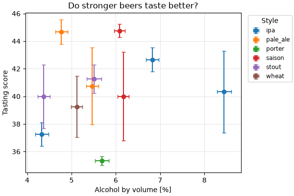

# Step 6 · Figures

In this step you draw the pieces with matplotlib: a figure from axes you give on
the command line, figures declared by name in `.samplekitrc`, and one the
model draws itself. A figure opens in a window — matplotlib needs tkinter or
PyQt in the environment for one, and says so — or is written to a file with
`-o` and `--write`, which needs neither.

Run every command from this folder, `06-figures`.

## Try it

```console
$ samplekit pieces list figures
$ samplekit pieces plot score                          # a window
$ samplekit pieces plot score -o score.pdf             # a preview: what it would write
$ samplekit pieces plot score -o score.pdf --write     # written
$ samplekit pieces plot -x radius -y modulus --group style -o radius-modulus.png --write
$ samplekit pieces plot modulus_by_style --query strong -o strong.png --write
$ samplekit pieces/alpha-titanium.md plot reduction_curve -o curve.png --write
$ samplekit score.pdf explain
```

## What you see

**Axes on the command line.** `-x` and `-y` name two numbers each piece holds:
a property, one part of it (`modulus.u`), or a table cell. One point per piece,
with error bars where a value has an uncertainty. `--group` draws one series
per value of a field, and `--kind` chooses `scatter`, `line`, `step`, `bar` or
`box`. Two columns of one table, `-x ageing.day -y
ageing.hardness --kind line`, draw a curve per piece; without `--kind
line`, its points.

A piece without the value is left out, and said:
`warning: 1 of 12 samples not drawn: no modulus` — the gamma zinc, still
ageing.

**Declared figures.** A figure you draw often is declared, like a query:

```toml
[figure.score]
kind = "scatter"
x = "modulus"
y = "score"
group = "style"
title = "Do stronger alloys inspect better?"
legend = "outside"
```



Drawing a declared figure runs no code from the project: it never starts the
model.

**The model's figure.** For anything more — a fitted line, a reference line,
several panels — the model draws it, on axes SampleKit gives it:

```python
@sk.figure
def reduction_curve(self, ax):
    """How much of the sugar was eaten, day by day, against where it ended."""
    ax.plot(self.ageing.values("day"), self.ageing.values("nominal"), "o-")
    if self.reduction.value is not None:
        ax.axhline(self.reduction.value, color="0.5", linestyle="--")
    ax.set_xlabel("day")
    ax.set_ylabel("nominal reduction [%]")
```


## Labels and styles

An axis is labelled with the property's symbol and its unit, taken from a
**style**. A style is named once, `[style.figure]`, and the name is the key
every spelling of it uses: a unit's `figure = …` under `[unit."kg"]`, a
property's `symbol_figure = …` under `[property.modulus]`. This step's
`.samplekitrc` declares one for figures, in matplotlib's mathtext between
`$…$`, and one for LaTeX, `math`:

```toml
[style.figure]
[style.math]

[render]
figure_style = "figure"

[unit."kg"]
math = '\mathrm{kg}'        # for LaTeX: samplekit pieces --style math
figure = '$\mathrm{kg}$'    # for figures

[property.modulus]
symbol_figure = 'Modulus by volume'
```

The `math` spellings are for a table put into a LaTeX report:

```console
$ samplekit pieces --profile modulus --style math
```

`[matplotlib]` holds matplotlib's own settings, by their names, for every
figure the project draws; sizes are in centimetres.

## A file remembers where it came from

A figure written with `--write` is recorded in the project's history, so that
`explain` finds it again, even copied elsewhere, and says whether what it was
drawn from has changed since:

```text
score.pdf
  made      2026-09-27 17:27, by samplekit pieces plot score -o score.pdf --write
  written   score.pdf
  from      snapshot #1, 12 samples

nothing it was made from has changed since: it is up to date
made again as it was, from the project's folder: samplekit pieces plot score -o score.pdf --write --at dacba2b
```

`--at` draws the figure again from the project as it was then.

## Why

A figure in a paper should be made from the data by a command, so that it can
be made again, and so that you know when the data under it has changed.

- To understand: [the history](https://zelyph.github.io/SampleKit/latest/explanations/history.html),
  and how a file is found again.
- To look up: [`plot` and its options](https://zelyph.github.io/SampleKit/latest/reference/cli.html),
  [figures, styles and `[matplotlib]` in `.samplekitrc`](https://zelyph.github.io/SampleKit/latest/reference/configuration.html),
  [`@sk.figure`](https://zelyph.github.io/SampleKit/latest/reference/python.html).
- To do: [figures and tables for a paper](https://zelyph.github.io/SampleKit/latest/how-to/export-for-a-paper.html).

Next: [Step 7 · Two testers](../07-two-testers/README.md), two projects and the
TUI.
